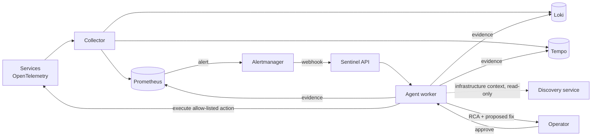

# AI Engineering Handbook

A hands-on AI engineering reference in two halves:

1. **[Handbook](handbook/README.md)**: one numbered learning track (000–012), from Python and
   LLM APIs through prompting, LangChain, RAG, Gemini, LangGraph, MCP, the OpenAI Agents SDK
   and CrewAI, to a research-agent capstone.
2. **The Sentinel platform**: a production-grade, AI-agentic observability platform that turns
   alerts into a root-cause analysis and a human-approved fix. It has two parts:
   - **[Sentinel](sentinel/)** (Python), the core: correlation, the investigation agents, RCA,
     human-in-the-loop remediation and audit.
   - **[Discovery](discovery/)** (Go + React), the infrastructure inventory and topology that
     Sentinel reads (read-only) for infrastructure context.

**New here?** Follow the [unified platform guide](docs/guide/unified-platform-guide.md) step by
step, or start learning with the [handbook](handbook/README.md) and the
[engineering and learning guide](docs/guide/agentic-engineering-guide.md).

It is also a worked example of **Forward Deployed Engineering (FDE)**. It takes one customer
problem from discovery through architecture, build, validation and production operations. Each
phase is documented in [docs/fde](docs/fde/README.md).

---

## Sentinel in one minute



When payments starts failing, three services alert: payments, checkout and frontend. Sentinel
then does the following:

1. **Groups** the alerts into *one* incident, using time and the service dependency graph.
2. **Investigates** with seven specialised agents (LangGraph). They pull golden signals from
   Prometheus, error logs from Loki and traces from Tempo, detect anomalies, and find where the
   errors *originate*.
3. **Identifies** payments as the root cause, with evidence and a confidence score.
4. **Proposes** remediations from its runbook knowledge base (RAG), limited to allow-listed
   actions.
5. **Waits for a human** to approve, then executes the action and records every step in an audit
   trail.
6. **Auto-resolves** the incident when the alerts clear, and writes an incident report.

Validated end to end on the full stack:

| Scenario | Time to identified root cause | Root cause and confidence | Time to resolved |
|---|---|---|---|
| Errors injected in payments | 75 s | payments, 68% | 168 s |
| Latency injected in inventory | 80 s | inventory, 76% | n/a (fault cleared by hand) |

See [docs/testing/test-strategy.md](docs/testing/test-strategy.md#validation-report).

## Quick start (full stack, about 3 minutes)

Prerequisites: Docker 24+ with Compose v2, about 4 GB of free RAM, and Python 3.10+ (for the
helper scripts). Optional: [uv](https://docs.astral.sh/uv/) to run the tests.

```bash
make up
```

This generates secrets into `deploy/compose/.env` and API keys into `.env.keys`, then builds and
starts 14 containers.

| URL | What | Login |
|---|---|---|
| http://localhost:8000 | Sentinel operator console | API key from `deploy/compose/.env.keys` |
| http://localhost:8000/docs | OpenAPI (Swagger UI) | — |
| http://localhost:3000 | Grafana: golden signals, platform and infrastructure dashboards | `admin` / `GRAFANA_ADMIN_PASSWORD` from `.env` |
| http://localhost:9090 | Prometheus | — |
| http://localhost:9093 | Alertmanager | — |

Run the use case. Wait about 2 minutes after startup so a baseline builds, then:

```bash
make demo-errors
```

Within about 90 seconds an incident appears in the console with root cause `payments`. Approve
`disable_fault_flag` and watch the error rate drop in Grafana. To run the same flow as an
automated test:

```bash
make e2e
```

Stop the stack with `make down`. To also delete its data, use `make clean`.

To add the discovery service, which gives investigations infrastructure context, run
`make up-discovery` instead of `make up`. Its UI is at http://localhost:8090 (dev token
`dev-admin`). See the [unified platform guide](docs/guide/unified-platform-guide.md#step-4-add-the-discovery-service)
for what it shows in Compose compared with Kubernetes.

## Developing Sentinel

```bash
cd sentinel
uv sync --extra dev
```

```bash
uv run pytest
```

```bash
uv run ruff check src tests && uv run mypy
```

| Task | Command |
|---|---|
| Lint and type-check | `make lint` (discovery: `make discovery-lint`) |
| Unit and integration tests (79 tests, 93% coverage) | `make test` |
| End-to-end test against the stack | `make e2e` |
| Load test (Locust, 50 users) | `make load` |
| Render Kubernetes manifests | `make k8s-render` |

## Repository layout

```
sentinel/          Core: agentic incident engine (Python): source, tests, Dockerfile, migrations
discovery/         Discovery + topology service (Go + React), read by Sentinel; own docs and Helm chart
demo-services/     Instrumented demo workload (frontend, checkout, payments, inventory)
deploy/compose/    Local full stack: OTel Collector, Prometheus, Alertmanager, Loki, Tempo, Grafana
                   (+ discovery with `--profile discovery`)
deploy/k8s/        Sentinel Kustomize base + dev/prod overlays
docs/              Guides, diagrams, ADRs, agents, use cases, FDE playbook, runbooks, testing
handbook/          Learning track 000-012, one README per module
scripts/           bootstrap-env.sh, demo.sh
_archive/          Git-ignored: removed legacy code and duplicates, for manual deletion (MANIFEST.md)
```

## Documentation map

| Document | Read it for |
|---|---|
| [Unified platform guide](docs/guide/unified-platform-guide.md) | **Step by step:** run Sentinel and discovery, connect them, verify, go to production |
| [Engineering and learning guide](docs/guide/agentic-engineering-guide.md) | Beginner-to-expert course, findings, target agentic architecture, roadmap |
| [ARCHITECTURE.md](ARCHITECTURE.md) | Components, boundaries, technology choices, quality attributes |
| [PROJECT_KNOWLEDGE.md](PROJECT_KNOWLEDGE.md) | **Start here if you are new (human or AI agent):** context, decisions, conventions, roadmap |
| [AIDLC.md](AIDLC.md) | How AI features are specified, built, evaluated, shipped and improved |
| [API_DOCUMENTATION.md](API_DOCUMENTATION.md) | Endpoints, auth, examples, MCP tools |
| [DEPLOYMENT_GUIDE.md](DEPLOYMENT_GUIDE.md) | Local, Compose, Kubernetes, CI/CD, backups and DR |
| [SECURITY.md](SECURITY.md) | Threat model, auth, secrets, incident history of this repo |
| [DEVELOPMENT_GUIDELINES.md](DEVELOPMENT_GUIDELINES.md) | Coding standards, branching, testing, contributions |
| [TROUBLESHOOTING.md](TROUBLESHOOTING.md) | Symptoms and fixes |
| [CHANGELOG.md](CHANGELOG.md) | Release history |
| [docs/](docs/README.md) | Diagrams, ADRs, agent specs, use cases, FDE phases, runbooks |

## Status and honest limits

Sentinel passed these checks locally:

- Unit, integration, migration, end-to-end and load tests.
- Static analysis and dependency audit.
- Compose deployment, and Kustomize rendering of both overlays.

These parts need a real cluster and cloud account and have **not** been exercised here:

- Applying the Kubernetes manifests to a cluster.
- The release workflow (image signing, publishing to GHCR).
- Managed-database backups.

See [DEPLOYMENT_GUIDE.md §9](DEPLOYMENT_GUIDE.md#9-environment-specific-dependencies) for exactly
what each environment must supply.

## License

[MIT](LICENSE)
