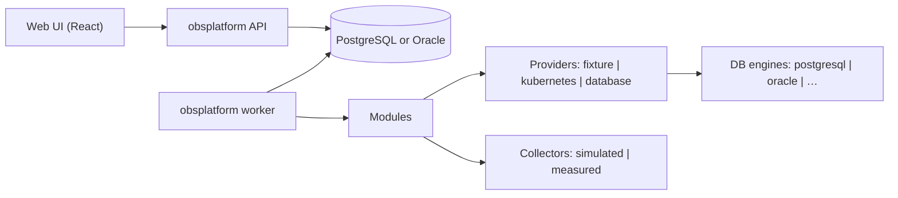

# Discovery service (`obsplatform`)

The **discovery and topology service** of the unified Sentinel platform. It discovers resources
(Kubernetes, databases, a simulated cloud estate), keeps a reconciled resource topology, and
collects metrics driven by that topology. Sentinel, the agentic incident engine in
[`../sentinel/`](../sentinel/), reads this topology **read-only** to add infrastructure context
(pods, nodes, databases, and which of them are missing or stale) to every investigation.

| Part of the platform | Role |
|---|---|
| [`sentinel/`](../sentinel/) | Alerts → correlation → investigation agents → root cause → human-approved fix |
| `discovery/` (this folder) | Inventory and topology of the infrastructure under those services |
| [Unified platform guide](../docs/guide/unified-platform-guide.md) | Step-by-step: run both, connect them, verify, deploy |

Go API and workers plus a React/TypeScript UI, on PostgreSQL or Oracle. Until 2026-11-24 this
folder was `observability-platform/`. Its legacy snapshot (`Monitoring-Boilerplate-Code/`, 33
repositories that could not be built) and the assessment PDF were moved to the git-ignored
`_archive/`. The documents under `docs/assessment/` and `docs/migration/` still describe them as
the historical baseline.

## MVP capabilities

| Capability | Status |
|---|---|
| Connection profiles (named accounts/clusters) with secret references, never secret values | Implemented |
| Discovery jobs: start (idempotent), progress, cancel, schedule, crash recovery | Implemented |
| Providers: **fixture** (deterministic simulated estate, no credentials) and **Kubernetes** (read-only; contract-tested, not validated on a live cluster here) | Implemented |
| **Database servers, any engine** through one generic provider: **PostgreSQL** and **Oracle** (CDB/PDB and non-CDB), both verified against real servers (Oracle: Database Free 23ai container database; 19c and non-CDB not yet run) — servers, databases/PDBs, tablespaces, and measured health metrics | Implemented ([ADR 0010](docs/adr/0010-generic-database-integration.md)) |
| Extensibility: integrations are **modules**; a resource-type **catalog** drives icons, facets, forms and fleet views, so a new domain needs no UI change | Implemented ([ADR 0012](docs/adr/0012-module-registry-and-catalog-driven-ui.md), [guide](docs/guides/extending.md)) |
| AWS, Azure, GCP providers | **Not implemented** (legacy collectors hold this logic; see roadmap) |
| Topology: typed directed relationships, reconciliation (added / changed / unchanged / missing / reactivated), change log, stale handling | Implemented |
| Metrics driven by topology: capability map per resource type, collection on schedule / after discovery / on demand, units and provenance | Implemented (simulated for fixture; measured for Kubernetes via metrics.k8s.io) |
| REST API `/api/v1` with OpenAPI 3.1, RFC 9457 errors, keyset pagination, health, Prometheus metrics, audit log | Implemented |
| Web UI: domain overview, **faceted Explorer**, topology map, **Databases** fleet view, resource detail with charts, generated connection forms, **global time range**, **command palette (Ctrl/Cmd+K)**, light/dark/system theme | Implemented ([UX benchmark](docs/product/ux-benchmark.md)) |
| Authentication | **Development mode only** (static demo tokens; refused in production). OIDC is a designed seam, not implemented |
| Platform store: **PostgreSQL or Oracle** (`OBS_STORE_DRIVER=oracle`); one contract suite for both; API suite and demo verified on Oracle Database Free 23ai | Implemented ([ADR 0011](docs/adr/0011-platform-store-portability.md)) |
| Packaging: OCI image, docker compose, Helm chart with public- and private-cloud overlays, CI workflow | Implemented (see verification for what ran locally) |

**Simulated data disclosure.** Everything from the `fixture` provider — resources and metrics, including its Oracle ERP estate — is generated locally, labelled `simulated` in data and UI, and is not a real measurement. The demo's "Local PostgreSQL (measured)" connection is real: it reads the demo's own PostgreSQL through a `pg_monitor`-only role.

## Architecture at a glance

One Go binary, `obsplatform`, runs as an **API** role and a **worker** role (same image, separate Deployments in Kubernetes); its one datastore is PostgreSQL or Oracle (chosen by `OBS_STORE_DRIVER`); the React app is served by the binary.



| Read next | |
|---|---|
| [High-level design](docs/design/hld.md) | scope, current vs target, deployment, trust boundaries |
| [Low-level design](docs/design/lld.md) | packages, API, job state machine, data model, metrics, **data structures and algorithms** |
| [ADRs](docs/adr/README.md) and [decision log](docs/decision-log.md) | decisions and rejected alternatives |
| [API spec](platform/contracts/openapi.yaml) | OpenAPI 3.1 (also served at `/api/v1/openapi.yaml`) |
| [Security and threat model](docs/security/threat-model.md) | controls, tests, gaps |
| [Diagram catalogue](docs/README.md#diagram-catalogue) | all diagrams (Mermaid) |
| [Deployment](docs/operations/deployment.md), [runbook](docs/operations/runbook.md), [configuration](docs/operations/configuration.md), [CI/CD](docs/operations/sdlc-and-cicd.md) | operations |
| [Migration and traceability](docs/migration/plan-and-traceability.md) | how existing capabilities are preserved, phases |
| [Verification](docs/verification.md) | commands run and results |
| [Extending the platform](docs/guides/extending.md) | add a database engine, provider or domain |
| [Gap review](docs/assessment/mvp-gap-review.md) and [product roadmap](docs/roadmap.md) | what is missing, and the path to production |

## Prerequisites (tested versions)

| Tool | Tested | Required for |
|---|---|---|
| Go | 1.27.4 | server (go.mod pins `toolchain go1.27.4`; Go downloads it if needed) |
| Node.js / npm | 24.21.0 / bundled | web build and tests (Node ≥ 22) |
| PostgreSQL | 18.3 (Homebrew) | local database (16+ expected to work; only 18.3 tested) — or Docker |
| make, bash, python3 | macOS defaults | scripts |
| Docker (optional) | 29.4.1 | container build and compose |
| Helm (optional) | 3.22.1 | Kubernetes install |

Dependencies are pinned (`platform/go.sum`, `platform/web/package-lock.json`). Production dependency surface: 6 Go modules (MIT, BSD-3-Clause) and 3 npm packages (MIT). Full list: [dependencies and licences](docs/inventory/dependencies-and-licenses.md), [tools and datastores](docs/inventory/tooling-and-datastores.md).

## Quick start (one command)

```bash
make demo
```

This starts a local PostgreSQL from your installed binaries (data in `.local/pg`, port 54329, loopback only), builds the UI and server, applies migrations, seeds two demo connections (the simulated estate and a measured connection to that same local PostgreSQL through a `pg_monitor`-only role), starts the server on <http://localhost:8080>, and runs the end-to-end smoke test. Expected tail:

```
  ok  discovery job_… succeeded: added=41 changed=0 unchanged=0 missing=0 reactivated=0
  ok  topology: 41 active resources, 77 relationships
  ok  metrics: 60 cpu.utilization points (%), sources=[simulated], simulated=true
  ok  database "Local PostgreSQL (measured)": PostgreSQL 127.0.0.1 discovered, db.connections=3 (measured)
  ok  web UI served
SMOKE PASS
```

Stop everything with:

```bash
make demo-stop
```

**Demo credentials (development only).** Sign in with token `dev-admin` (tenant `demo`, admin). Also `dev-operator`, `dev-viewer`, and `dev-acme-admin` (a second tenant, to show isolation). These tokens are public, work only with `OBS_AUTH_MODE=dev`, and the server refuses dev mode when `OBS_ENV=production`.

### With Docker instead of local PostgreSQL

```bash
docker compose -f deploy/compose/docker-compose.yml up --build
```

Then open <http://localhost:8080>. (In this workspace the image build was blocked by the Docker daemon's registry proxy; see [verification](docs/verification.md).)

## End-to-end walkthrough

1. **Select the demo environment.** Open <http://localhost:8080>, choose `dev-admin`, *Sign in*. The overview shows a purple *simulated* notice.
2. **Run discovery.** *Connections* → "Demo estate (simulated)" → *Run discovery*. *Discovery jobs* shows the job moving queued → running → succeeded with page progress and counts.
3. **See reconciliation.** Run discovery again. The fixture drifts deterministically: `i-east-web-03` becomes **missing** (kept, shown hatched/`stale`), `i-east-batch-01` is **added**, the east database label is **changed**. The job page lists each change. A third run reactivates web-03.
4. **Inspect topology.** *Topology* shows the layered graph (VPCs → subnets/load balancers → instances → pods); switch to *Table* for an accessible relationship list; filter by connection, type or search; click a node for details.
5. **View metrics.** Click a resource (for example `i-east-web-01`) → *Metrics* shows CPU, memory and network with units, latest value, a chart for the global time range (top bar, 15 min – 7 days) with min–max band, *Show data* table, and the *simulated* badge.
6. **Explore.** *Explorer* filters every resource by domain, type, engine, provider, region, environment and status with live counts; the URL holds the view so it can be bookmarked. Press **Ctrl/Cmd+K** (or `/`) anywhere to jump to a page, domain or resource by name.
7. **Databases.** *Databases* lists every database server of every engine with the same columns (connections, active sessions, transactions/s, cache hit, storage, CPU where the engine reports it) and tablespaces by utilization. The Oracle ERP rows are simulated; "PostgreSQL 127.0.0.1" is measured live. *Add database* opens a form where you pick the engine; the form shows the read-only grants that engine needs.

The same flow over the API:

```bash
TOKEN=dev-admin
curl -s -H "Authorization: Bearer $TOKEN" localhost:8080/api/v1/connections | python3 -m json.tool
```

Then, with a connection ID from that output:

```bash
curl -s -X POST -H "Authorization: Bearer $TOKEN" -H "Idempotency-Key: demo-1" localhost:8080/api/v1/connections/<connection-id>/discovery-jobs
```

## Development

| Task | Command |
|---|---|
| Install pinned dependencies | `make deps` |
| Local DB start / stop / wipe | `make db-up`, `make db-down`, `make db-destroy` |
| Migrate, seed, run server (serves built UI) | `make migrate`, `make seed`, `make run` |
| UI with hot reload (proxies API on :8080) | `make web-dev` → <http://localhost:5173> |
| Format, lint, type-check | `make fmt`, `make lint`, `make typecheck` |
| All tests (Go against real PostgreSQL, UI) | `make test` |
| Smoke test a running server | `make smoke URL=http://localhost:8080` |
| Static binary, image | `make build`, `make docker-build` |
| Vulnerability scan, SBOM, licence inventory | `make vuln`, `make sbom`, `make licenses` |
| Everything CI runs before packaging | `make check` |
| Oracle as the platform store: start Oracle Free (Docker), run store contract + API suite on it, run the demo on it | `make oracle-up`, `make test-oracle`, `make demo-oracle` |

Go integration tests need PostgreSQL: they use `OBS_TEST_DATABASE_URL` if set, otherwise start a throwaway server from `initdb`/`pg_ctl` on your PATH; `make test-go` sets `OBS_TEST_REQUIRE_DB=1` so a missing database fails instead of silently skipping.

## Configuration and secrets

All settings are `OBS_*` environment variables, validated at start-up; the only required one is `OBS_DATABASE_URL`. Reference: [configuration.md](docs/operations/configuration.md).

Credentials are never stored or returned by the API. A connection holds a **reference**: `env:OBS_SECRET_<NAME>` (only that prefix is readable) or `file:<name>` under `OBS_SECRET_DIR`. Config keys that look like secrets (`password`, `token`, …) are rejected. Provider endpoints must be HTTPS and listed in `OBS_EGRESS_ALLOWLIST`; cloud metadata addresses are always refused.

## Operations

- Health: `GET /healthz` (process), `GET /readyz` (database, migrations, shutdown), `GET /metrics` (Prometheus).
- Logs: JSON to stdout with request ID, tenant, subject, route, status, duration; secrets are never logged.
- Data retention: samples 7 days, missing resources purged 7 days after disappearing, jobs 30 days, audit 90 days (configurable).
- Backup/restore and migration rollback guidance: [runbook](docs/operations/runbook.md).
- Troubleshooting table: [runbook](docs/operations/runbook.md#troubleshooting).

## Deployment

One image and one Helm chart for public and private Kubernetes; only values differ (`deploy/helm/obs-platform/values-public-cloud.yaml`, `values-private-cloud.yaml`). Migrations run as a Helm hook. The chart defaults to production with OIDC, which **fails fast** because OIDC is not implemented yet; `values-dev.yaml` is for throwaway evaluation clusters. Details: [deployment.md](docs/operations/deployment.md).

## Supported providers

| Provider | Discovery | Metrics | Credentials | Validation |
|---|---|---|---|---|
| `fixture` | deterministic simulated estate (41 resources incl. an Oracle CDB with PDBs and tablespaces, 2 regions, drift between runs) | simulated | none | unit, contract, integration, E2E |
| `kubernetes` | nodes, namespaces, deployments, pods, services; relationships from placement, owners, selectors | measured via metrics.k8s.io (CPU, memory) | bearer token reference; read-only ClusterRole | contract tests against recorded API shapes; **not run against a live cluster** |
| `database` / `postgresql` | server, databases, tablespaces | measured: connections, active sessions, transactions/s, cache hit ratio, storage | password reference; role in `pg_monitor`; sessions forced read-only | unit + integration against real PostgreSQL 18.3, E2E, smoke |
| `database` / `oracle` | instance, PDBs (or non-CDB), tablespaces | measured: sessions, transactions/s, buffer cache hit, host CPU, tablespace used/utilization | password reference; `SELECT_CATALOG_ROLE` + `CONTAINER_DATA=ALL` (common user for CDB) | unit tests + live run on Oracle Database Free 23ai (CDB); 19c and non-CDB not run |
| AWS, Azure, GCP | not in the MVP | — | — | — |

## Known limitations

- Development authentication only; no OIDC, no per-resource authorization.
- Kubernetes adapter not validated against a live cluster; no watch/incremental discovery.
- Time series in PostgreSQL with 7-day retention; plan ClickHouse or partitioning past a few thousand resources ([LLD §9.5](docs/design/lld.md#95-time-series-storage-and-query)).
- The Oracle platform store is verified on Oracle Database Free 23ai only (not 19c, Autonomous Database or RAC), and writes snapshots row by row (slower than PostgreSQL at large volumes).
- Database monitoring is health-level; no query-level analytics (statements, plans, wait events) yet.
- English-only UI; no edge profile; no alerting.
- The archived legacy repositories contain committed keys and keystores (file names verified, contents not read). Their owners should rotate them before anyone restores or shares that archive.
- No SLOs or load tests: traffic and scale requirements are unknown.

## Security posture

Suitable for local evaluation and development. Not production-ready: see the [threat model's gap list](docs/security/threat-model.md#4-known-gaps-before-production). No compliance or certification is claimed.

## Roadmap

The path to a production product is in [docs/roadmap.md](docs/roadmap.md): Phase 0 MVP hardening (live Oracle tests, CI run, image build, browser E2E) → Phase 1 production foundations (OIDC/RBAC, secret managers, signed images, HA, self-observability) → Phase 2 coverage (AWS/Azure/GCP, more database engines, query analytics, alerting) → Phase 3 scale and insight (columnar metrics, dashboards, traces, anomaly detection) → Phase 4 ecosystem (partner SDK, legacy decommission). Legacy capability migration: [migration plan](docs/migration/plan-and-traceability.md).

## Repository layout

```
platform/             Go module (cmd/, internal/, contracts/) and web/ (React + TypeScript)
deploy/               docker/Dockerfile, compose/ (standalone), helm/obs-platform/
scripts/              dev-postgres.sh, demo.sh, go-sbom.sh, license-inventory.sh
docs/                 design, ADRs, security, operations, migration, inventory, verification
```

CI runs from the repository root: [`.github/workflows/discovery-ci.yml`](../.github/workflows/discovery-ci.yml).
Inside the unified Compose stack it runs as the `discovery` profile (`make up-discovery` at the
repo root).
