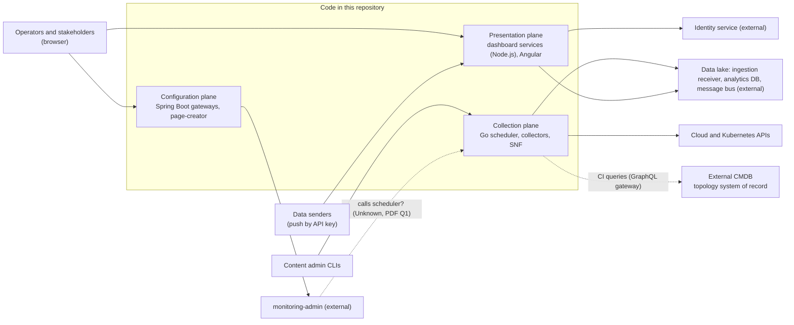
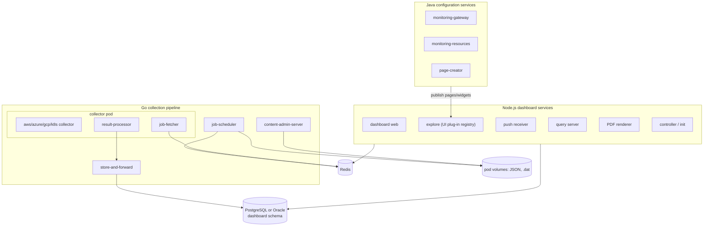
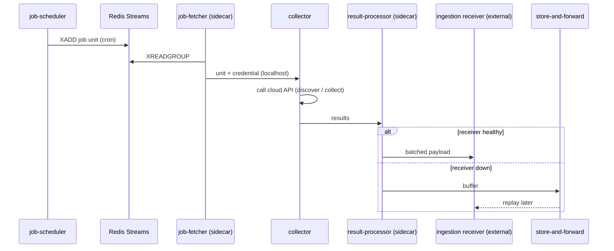
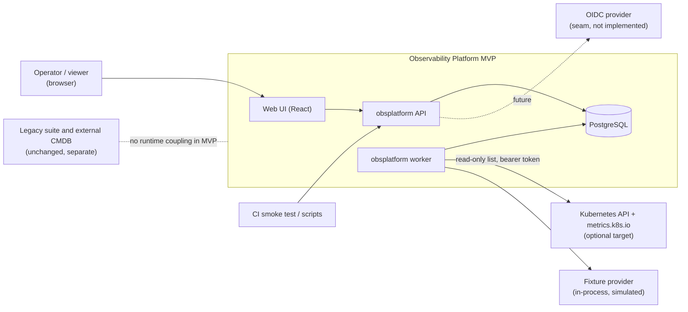
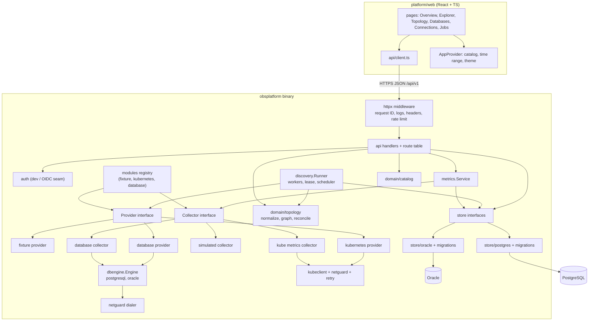
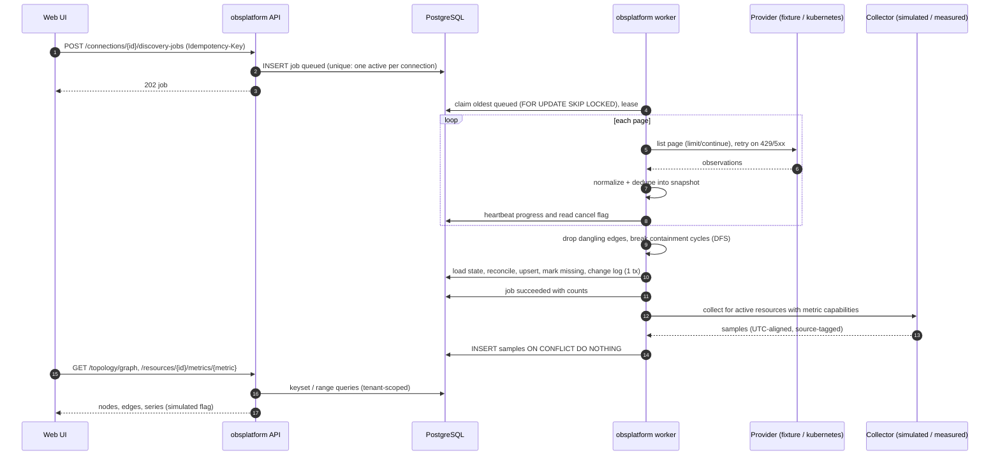
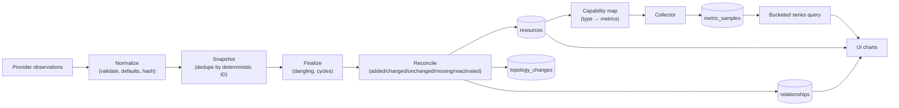
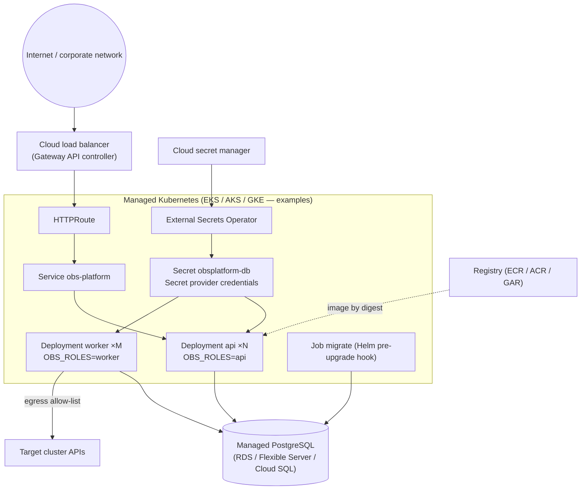
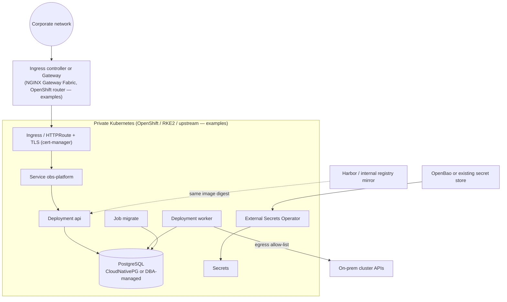
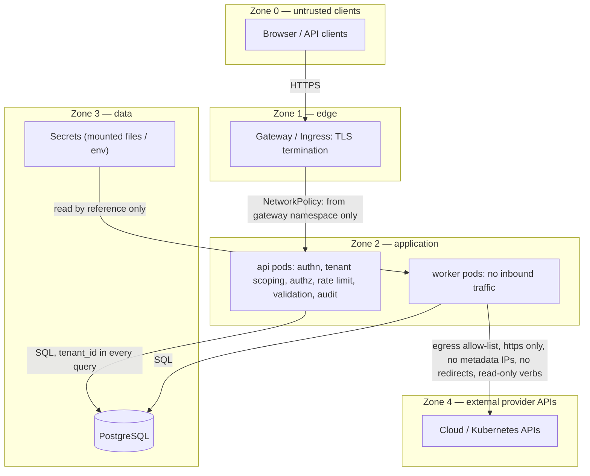

# High-level design — Observability Platform MVP

Status: implemented MVP (vertical slice) plus target-state design. Labels: **Verified**, **Assumption**, **Unknown**, **Recommendation** (defined in [../assessment/inventory-and-reconciliation.md](../assessment/inventory-and-reconciliation.md)).

## 1. Product goals and scope

**Goal of the MVP (from the brief).** Preserve the existing product capabilities evidenced by the repository and add the missing capability: discover cloud resources, build and maintain a resource topology, and use that topology to drive metric collection and presentation — runnable end to end on a laptop without cloud credentials.

### 1.1 In scope (implemented, Verified by tests and the smoke run)

| # | Capability | Where |
|---|---|---|
| M1 | Connection profiles with secret-safe credential references and static + live validation | `platform/internal/api/connections.go`, `internal/secrets` |
| M2 | Discovery jobs: queue, lease, progress, cancel, retry recovery, idempotent start, schedule | `internal/discovery/runner.go`, `internal/store/postgres/postgres.go` |
| M3 | Provider-neutral discovery interface; deterministic fixture provider; read-only Kubernetes adapter (contract-tested) | `internal/discovery/{provider.go,fixture,kubernetes}` |
| M4 | Normalized topology (typed directed edges), reconciliation (added/changed/unchanged/missing/reactivated), change log, purge window | `internal/domain/topology`, `internal/store/postgres/topology.go` |
| M5 | Topology-driven metrics: capability map by resource type, simulated (offline) and measured (Kubernetes metrics API) collectors, idempotent time-series storage, bucketed queries | `internal/domain/metrics`, `internal/metrics/**` |
| M6 | Versioned REST API with OpenAPI 3.1, RFC 9457 errors, keyset pagination, health/readiness, Prometheus metrics, audit log | `platform/contracts/openapi.yaml`, `internal/api`, `internal/httpx` |
| M7 | React + TypeScript UI: overview, connections, jobs, topology graph with table fallback, resource search, resource detail with metrics | `platform/web/src` |
| M8 | Development auth with tenant scoping; OIDC seam | `internal/auth` (ADR 0006) |
| M9 | Local one-command demo, OCI image, compose file, Helm chart with public/private overlays, CI workflow | `Makefile`, `scripts/`, `deploy/`, `.github/workflows/platform-ci.yml` |
| M10 | Generic database integration: one engine-neutral provider and measured collector; engines PostgreSQL (verified against a real server) and Oracle (unit-tested against canned catalog results, **not** run against a live Oracle) | `internal/dbengine/**`, `internal/discovery/database`, `internal/metrics/dbmetrics` (ADR 0010) |
| M11 | Module registry and resource-type catalog: integrations plug in as modules; the UI renders any type, provider form and domain from API metadata | `internal/modules`, `internal/domain/catalog`, `GET /api/v1/catalog` (ADR 0012) |
| M13 | Platform store on **PostgreSQL or Oracle** (`OBS_STORE_DRIVER`), one contract suite for both; full API suite and demo verified on Oracle Database Free 23ai | `internal/store/{backend,oracle,storetest}` (ADR 0011) |
| M12 | Explorer UX: faceted search with counts, global time range, command palette (Ctrl/Cmd+K), light/dark/system theme, engine-agnostic Databases fleet view, generated connection forms | `platform/web/src`, `GET /api/v1/resources/facets`, `GET /api/v1/fleet` ([../product/ux-benchmark.md](../product/ux-benchmark.md)) |

### 1.2 Non-goals of this MVP (not implemented; extension points documented)

Alerting and on-call; a custom query language; RBAC administration UI; automatic remediation; service mesh; multi-region HA; MySQL/SQL Server/MongoDB engines (the engine contract is in place; [../guides/extending.md](../guides/extending.md)); query-level database analytics (query samples, explain plans, wait events); AWS/Azure/GCP adapters (the legacy Go collectors hold that logic but cannot be built from this snapshot — §6); rewriting the 24 legacy capabilities F1–F24 (mapped in [../migration/plan-and-traceability.md](../migration/plan-and-traceability.md)); OIDC.

### 1.3 Architecture drivers

| Driver | Source | Label |
|---|---|---|
| Runs end to end offline, no credentials | Brief | Verified requirement |
| Go back end, React + TypeScript front end | Brief; PDF D5 and §6.9 | Verified requirement |
| Same artifacts on public and private Kubernetes | Brief; PDF §10 | Verified requirement |
| Read-only, least-privilege discovery; secrets never stored in plaintext | Brief; PDF findings S1–S6 | Verified requirement |
| Multi-tenancy by tenant identifier | Legacy schema and routes (PDF F23, p. 19) | Verified (legacy) |
| PostgreSQL or Oracle as system of record | PDF D2; legacy `pg_driver`/`ora_driver` | Verified (legacy); **implemented** for the new tables (ADR 0011; tested on Oracle 23ai, not 19c) |
| SLOs, traffic, resource counts, RPO/RTO | PDF Q6, Q9 | **Unknown** — no numbers in code; the MVP sets bounded limits instead (§5) |

## 2. Current state (Verified unless marked)

### Diagram C1 — current system context
*Phase:* current state. *Purpose:* what the existing code talks to. *Evidence:* outbound URLs in configuration and umbrella chart dependencies (PDF §2.3; repository paths in the inventory). *Assumption:* which external systems are mandatory in a minimal install is **Unknown**.

Legend: solid = verified call path; dotted = inferred or partially evidenced.

### Diagram C2 — current containers
*Phase:* current state. *Evidence:* one box per Deployment template in per-service charts. *Unknown:* threshold processor and data broker interfaces (source absent).

### Diagram C3 — current collection flow
*Phase:* current state, runtime. *Evidence:* `job-scheduler/scheduler/client/redis.go` (XADD), `job-fetcher/.../consumer/client.go` (XREADGROUP), `result-processor/.../task/batching.go`, `monitoring-snf/snf/pipeline.go` (PDF p. 14).

**Current deployment** (Verified from charts; sizes Unknown): one umbrella Helm chart per central cluster, optional reduced edge chart forwarding to the centre (PDF Diagram 4). Not redrawn here because node topology and sizes are not in the repository.

## 3. Target state for the MVP slice

### 3.1 Design principles applied

1. **Modular monolith, two roles.** One Go binary (`obsplatform`) with `api` and `worker` roles deployed separately (ADR 0002). Discovery, topology and metrics share one data-ownership boundary (the topology), so splitting them now would add network hops and distributed transactions for no scaling benefit yet.
2. **Ports and adapters.** Providers, collectors, authenticator, secret resolver and store are interfaces; provider SDK types never cross into `internal/domain`.
3. **Portable by default.** PostgreSQL via standard protocol, OCI image, Helm, Gateway API or Ingress, env-var configuration, secret references — nothing vendor-specific in the image.
4. **Bounded everything.** Page sizes, snapshot sizes, job events, query ranges, rate limits, timeouts and retention all have explicit limits (LLD §6).

### Diagram T1 — target system context (MVP)
*Phase:* target design. *Purpose:* actors and external systems of the new slice. *Assumption:* in production, identity comes from an OIDC provider (not implemented).

### Diagram T2 — components and dependency direction
*Phase:* target design. *Evidence:* Go import graph of `platform/` (Verified by `go vet` and compile).

Rule: arrows point from dependent to dependency; `domain/*` imports nothing with I/O.

### Diagram T3 — discovery → topology → metrics (runtime sequence)
*Phase:* runtime. *Evidence:* `internal/discovery/runner.go`, `internal/app/app.go` (`OnSucceeded`), `internal/metrics/service.go`; exercised by `TestEndToEndDiscoveryTopologyMetrics` and the smoke run.

### Diagram T4 — data flow
*Phase:* target design, runtime.

## 4. Deployment

The same OCI image (`deploy/docker/Dockerfile`, distroless, non-root, static binary with the built UI) and the same Helm chart (`deploy/helm/obs-platform`) serve both environments; only a values overlay differs (ADR 0007). Details: [../operations/deployment.md](../operations/deployment.md).

### Diagram D1 — public-cloud deployment
*Phase:* deployment (target). *Assumption:* managed PostgreSQL and a Gateway API controller are available; names of vendor services are examples only.

### Diagram D2 — private-cloud deployment
*Phase:* deployment (target). *Assumption:* an on-premises distribution, an Ingress or Gateway controller, and an internal registry mirror exist.

| Concern | Portable interface | Public-cloud example | Private-cloud example | Environment-specific work |
|---|---|---|---|---|
| Runtime | Kubernetes ≥ 1.27, OCI image | EKS/AKS/GKE | OpenShift/RKE2 | Node pools, quotas |
| Edge | Gateway API `HTTPRoute`, Ingress fallback | Cloud LB controller | Gateway/Ingress controller | Certificates, DNS |
| Database | PostgreSQL wire protocol, `OBS_DATABASE_URL` | Managed PostgreSQL | CloudNativePG / DBA cluster | Backups, HA, TLS |
| Secrets | Kubernetes Secret (files/env) | Secret manager via ESO | OpenBao via ESO | Secret paths, rotation |
| Telemetry | stdout JSON logs, Prometheus `/metrics` | Managed Prometheus/logging | Prometheus/Loki | Scrape and retention |
| Egress to targets | `OBS_EGRESS_ALLOWLIST` + NetworkPolicy CIDRs | Provider API hosts | Internal API servers | Firewall rules |

## 5. Security zones and trust boundaries

### Diagram S1 — trust boundaries
*Phase:* security (target and MVP). *Evidence:* `internal/httpx`, `internal/auth`, `internal/netguard`, chart `networkpolicy.yaml`.

Threats and controls: [../security/threat-model.md](../security/threat-model.md).

## 6. Current-to-target component mapping

| Current component (Verified) | MVP disposition | Rationale |
|---|---|---|
| Collectors' discovery (collector discovery packages) | **Retained, not integrated** in the MVP; their provider logic is the source for future adapters behind `discovery.Provider` | Cannot be built from the snapshot (private frameworks); a clean interface lets each be ported as an adapter |
| External CMDB as topology store | **Coexists**; MVP topology tables are additive | No migration decision; avoids breaking existing customers |
| Collection metrics (CloudWatch etc. via collectors) | **Retained**; MVP adds a topology-driven collector interface with simulated and Kubernetes implementations | Same reason as above |
| Dashboard services / UI plug-in framework / Java gateways / Angular UIs | **Unchanged**; React UI covers only the new slice | Full rewrite is phase 4 of the PDF plan |
| Job scheduler (in-memory + JSON files) | Pattern **not reused**; MVP jobs are in PostgreSQL with leases | Removes single-replica constraint flagged in PDF §3.6 |

Full capability traceability (F1–F24 and M1–M9): [../migration/plan-and-traceability.md](../migration/plan-and-traceability.md).

## 7. Architecture decisions

| ADR | Decision |
|---|---|
| [0001](../adr/0001-new-platform-slice-beside-legacy.md) | Build the MVP as a new `platform/` slice beside the legacy repositories |
| [0002](../adr/0002-modular-monolith-with-roles.md) | One Go binary with `api` and `worker` roles |
| [0003](../adr/0003-postgresql-only-store.md) | PostgreSQL for topology, jobs and MVP time series; ClickHouse later behind the metrics store |
| [0004](../adr/0004-deterministic-ids-and-reconciliation.md) | Deterministic IDs, content hashes and complete-run-only missing marking |
| [0005](../adr/0005-database-backed-job-queue.md) | Database-backed job queue with leases instead of Redis Streams |
| [0006](../adr/0006-auth-dev-mode-and-oidc-seam.md) | Development auth now; OIDC seam for production |
| [0007](../adr/0007-one-image-one-chart.md) | One image and one Helm chart for public and private cloud |
| [0008](../adr/0008-minimal-dependencies.md) | Standard library first; minimal, permissive dependencies |
| [0009](../adr/0009-kubernetes-adapter-without-client-go.md) | Kubernetes adapter on `net/http` instead of client-go |

Decision log with dates: [../decision-log.md](../decision-log.md).
