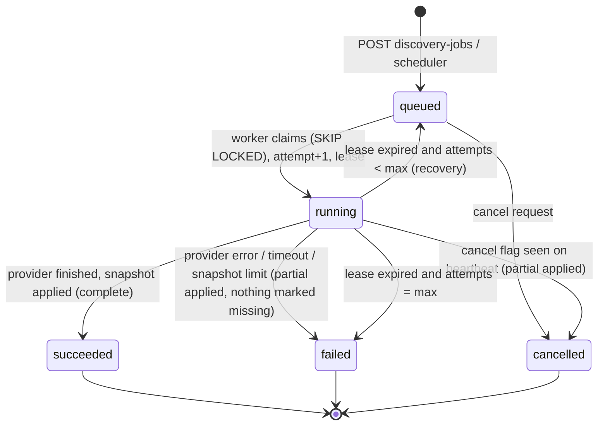
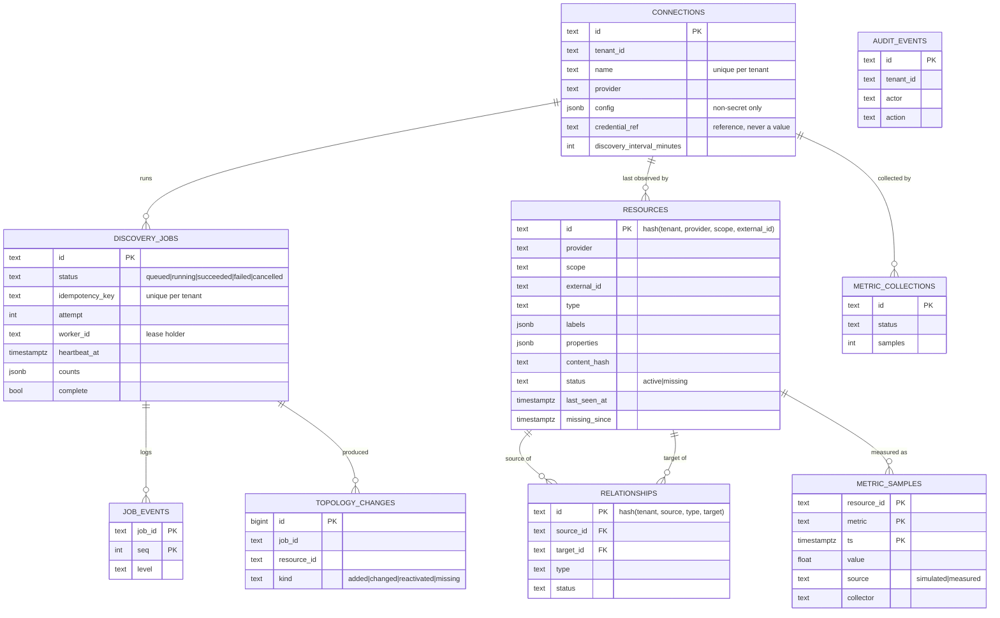

# Low-level design — Observability Platform MVP

Everything in this document describes code that exists in `platform/` unless labelled **Recommendation**. Paths are relative to `platform/`.

## 1. Code structure and dependency direction

```
platform/
  cmd/obsplatform/        main: serve | migrate up|status | seed | version
  cmd/smoke/              end-to-end smoke test (HTTP client only)
  contracts/              openapi.yaml (embedded; served at /api/v1/openapi.yaml)
  internal/
    domain/topology/      types, normalization, Snapshot, Graph (BFS, DFS back edges), Reconcile   — no I/O
    domain/metrics/       metric catalogue, units, sources                                        — no I/O
    domain/catalog/       domains and resource types (display, icon, key metric)                  — no I/O
    store/                repository interfaces, filters, cursors
    store/postgres/       pgx implementation, embedded SQL migrations, migration runner
    store/oracle/         Oracle implementation (database/sql + go-ora), Oracle migrations (ADR 0011)
    store/backend/        opens the store selected by OBS_STORE_DRIVER
    store/storetest/      driver-independent store contract, run by both implementations
    discovery/            Provider interface, Registry, Runner (workers, lease, scheduler)
    discovery/fixture/    deterministic simulated estate
    discovery/kubernetes/ read-only Kubernetes adapter
    discovery/database/   generic database-server provider (engine chosen per connection)
    dbengine/             Engine contract, Querier, Inventory/Readings, registry
    dbengine/postgresql/  PostgreSQL engine (pgx, read-only sessions)
    dbengine/oracle/      Oracle engine (go-ora, pure Go)
    dbengine/enginetest/  canned-result Querier for engine unit tests
    modules/              integration bundles: providers + collectors, start-up consistency checks
    metrics/              Collector interface, Service (trigger, loop, concurrency)
    metrics/simulated/    deterministic generator
    metrics/kubemetrics/  metrics.k8s.io collector
    metrics/dbmetrics/    measured database collector (gauges + counter-to-rate)
    kubeclient/           minimal GET-only Kubernetes REST client (limit/continue)
    netguard/             egress policy and SSRF-safe HTTP client
    retry/                capped exponential backoff with full jitter
    secrets/              credential references (env:OBS_SECRET_*, file:)
    auth/                 Authenticator interface, dev authenticator, roles → permissions
    httpx/                middleware, problem responses, rate limiter
    api/                  route table and handlers
    app/                  wiring, HTTP server, roles, retention loop, graceful shutdown
    telemetry/            slog setup, Prometheus text registry
    config/               env loading and validation
    ids/                  time-ordered random IDs, deterministic hash IDs
    testdb/               isolated PostgreSQL for tests
    testdb/oratest/       isolated Oracle schemas (throwaway users) for tests
  web/                    React + TypeScript (Vite)
```

Rules (Verified by compilation): `domain/*` imports only `ids` and the standard library; providers and collectors import `domain`, never `store/postgres`; `api` depends on interfaces (`store.Store`, `discovery.Registry`, `metrics.Service`, `auth.Authenticator`). Provider SDK or wire types (`kubeclient.ObjectMeta`) never appear in `domain` or `store`.

### Key interfaces

```go
// discovery/provider.go
type Provider interface {
    Info() Info
    ValidateConfig(cfg map[string]any, credentialRef string) []FieldError // static, no network
    Check(ctx context.Context, req Request) error                          // read-only probe
    Discover(ctx context.Context, req Request, emit Emit) error            // page by page
}
// metrics/service.go
type Collector interface {
    Name() string
    Source() metrics.Source // simulated | measured
    Collect(ctx context.Context, req Request) ([]metrics.Sample, error)
}
// dbengine/dbengine.go — one implementation per database product
type Engine interface {
    Name() string; DisplayName() string; DefaultPort() int
    Open(t Target, password string, dial DialFunc) (*sql.DB, error) // lazy; dials only through the guard
    MinimumPrivileges() string
    Inventory(ctx context.Context, q Querier) (Inventory, error)     // instance, databases, tablespaces
    Sample(ctx context.Context, q Querier) (Readings, error)         // gauges and cumulative counters
}
// modules/modules.go — how integrations are installed
type Module interface { Name() string; Description() string; Build(Deps) Contribution }
// auth/auth.go
type Authenticator interface { Authenticate(*http.Request) (Principal, error); Mode() string }
// store/store.go — Connections, Jobs, Topology, Metrics, Audit, Retention (composed into Store)
type Backend interface { Store; Driver() string; MigrateUp(ctx) ([]MigrationState, error); MigrationStatus(ctx) ([]MigrationState, error) }
```

### React app structure

`web/src/api` (typed client, types mirroring OpenAPI), `lib` (formatting, hash router, `useAsync` polling hook, layered graph layout), `components` (badges, `LineChart` with data-table fallback, `GraphView` with keyboard-focusable nodes), `pages` (SignIn, Overview, Explorer (`Resources`), Topology, Databases, Connections, Jobs, ResourceDetail). `lib/context.tsx` holds app-wide state: the catalog (fetched once), the global time range and the theme (per-viewer preferences in `localStorage`, guarded). `components/CommandPalette` (ARIA combobox) and `components/Icon` (catalog icon keys with domain fallback). Provider forms are generated from `configFields` (`options` → select). No router, state or chart library is used (ADR 0008).

## 2. API contract

Source of truth: [`platform/contracts/openapi.yaml`](../../platform/contracts/openapi.yaml) (OpenAPI 3.1). `TestOpenAPIMatchesRouteTable` fails if a route or its permission differs between code and spec.

| Method and path | Permission | Notes |
|---|---|---|
| GET /healthz, /readyz, /metrics, /api/v1/openapi.yaml | public | readiness checks DB, pending migrations, shutdown |
| GET /api/v1/me | authenticated | principal, tenant, permissions |
| GET /api/v1/catalog | authenticated | domains, resource types, metric definitions, relationship types, installed modules |
| GET /api/v1/resources/facets | topology:read | counts per domain, type, provider, region, status, engine, env; each facet ignores its own filter |
| GET /api/v1/fleet | metrics:read | resources of a `type` or `domain` with latest values of up to 12 metrics |
| GET /api/v1/providers | connections:read | config field schema per provider |
| GET, POST /api/v1/connections | connections:read / write | POST validates config, rejects secret-like keys |
| GET /api/v1/connections/{id} | connections:read | includes latest job |
| POST /api/v1/connections/{id}/validate | connections:write | static + live read-only check |
| POST /api/v1/connections/{id}/discovery-jobs | discovery:run | `Idempotency-Key`; 202 new, 200 replay, 409 active |
| POST /api/v1/connections/{id}/metric-collections | metrics:collect | 202; 409 if one is running |
| GET /api/v1/discovery-jobs[/{id}[/events]] | discovery:read | events bounded per job |
| POST /api/v1/discovery-jobs/{id}/cancel | discovery:run | queued → cancelled; running → cooperative |
| GET /api/v1/resources[/{id}] | topology:read | search `q`, `type`, `domain`, `provider`, `region`, `status`, `connectionId`, `label=k=v` |
| GET /api/v1/resources/{id}/neighborhood | topology:read | BFS, depth ≤ 4, maxNodes ≤ 500 |
| GET /api/v1/relationships, /relationship-types | topology:read | filter by type, status, endpoint |
| GET /api/v1/topology/summary, /graph, /changes | topology:read | graph capped at 1000 nodes with cycle diagnostics |
| GET /api/v1/metric-definitions | metrics:read | catalogue |
| GET /api/v1/resources/{id}/metrics[/{metric}] | metrics:read | capabilities + latest; bucketed series |
| GET /api/v1/metric-collections[/{id}] | metrics:read | run history |
| GET /api/v1/audit-events | audit:read | admin only |

**Example — start a job and replay it**

```http
POST /api/v1/connections/con_01a1ea1b6d027b0418fc2b9a45bc/discovery-jobs
Authorization: Bearer dev-admin
Idempotency-Key: ui-6f1c...

HTTP/1.1 202 Accepted
Location: /api/v1/discovery-jobs/job_01a1ea1c8eb152051a3a0edff205
{"id":"job_01a1...","status":"queued","trigger":"manual","attempt":0,"progress":{"phase":"pending",...},"counts":{...}}
```
Repeating the same request returns `200` with the same job. A different request while it runs returns:
```json
{"type":"urn:obsplatform:problem:job_active","title":"Conflict","status":409,"code":"job_active",
 "detail":"the connection already has a queued or running discovery job","requestId":"req_...","extra":{"activeJobId":"job_01a1..."}}
```

**Validation and errors.** Bodies: JSON only, ≤ `OBS_MAX_BODY_BYTES` (1 MiB), unknown fields rejected, single object. Path IDs are pattern-checked before any query. Errors are RFC 9457 with `code`, `requestId` and per-field `errors`. Codes: `validation_failed`, `invalid_body`, `invalid_cursor`, `unauthenticated`, `forbidden`, `not_found`, `conflict`, `job_active`, `collection_in_progress`, `no_collector`, `provider_disabled`, `rate_limited`, `internal`.

**Pagination.** Keyset cursors (opaque base64url JSON of the sort key): resources by `(name, id)`, jobs by `(created_at DESC, id DESC)`, relationships by `id`, changes by `id DESC`. Cost per page is O(log n + limit) on the supporting index, unlike OFFSET which is O(offset + limit). `limit` 1–500, default 50.

**Versioning.** `/api/v1` is additive-only; clients ignore unknown fields; breaking changes go to `/api/v2` with both served during a deprecation window (window length is stakeholder decision D7).

## 3. Discovery job state machine



Invariants (enforced in SQL, tested in `store/postgres/postgres_test.go`):

- At most one `queued|running` job per connection: partial unique index `discovery_jobs_one_active_uq`.
- `Idempotency-Key` is unique per tenant: `discovery_jobs_idempotency_uq`; replay returns the original job; reuse for another connection returns 422.
- Only the lease holder can heartbeat or finish (`WHERE worker_id=$2 AND status='running'`); a worker that lost its lease stops without writing.
- Claim is `UPDATE … WHERE id = (SELECT … FOR UPDATE SKIP LOCKED LIMIT 1)`: exclusive under concurrency (`TestClaimIsExclusiveUnderConcurrency`, 6 workers × 12 jobs).
- Recovery requeues a dead worker's job (discovery is read-only, so re-running is safe) until `OBS_DISCOVERY_MAX_ATTEMPTS`, then fails it.
- Job events are capped at `OBS_MAX_JOB_EVENTS` (200) per job.

## 4. Data model

### Diagram E1 — entity relationships
*Phase:* design (implemented in `store/postgres/migrations`).



### Ownership, constraints and indexes

- One owner: the `obsplatform` binary (both roles) owns every table above. No other service reads them directly; legacy services do not share them. If the slice is later split, `metric_samples` moves first (behind `store.Metrics`), and cross-service reads go through the API.
- Every table has `tenant_id`; every query filters on it. Resource and relationship IDs include the tenant in their hash, so IDs cannot collide across tenants.
- Check constraints: allowed statuses/types; `status='missing' ⇔ missing_since IS NOT NULL`; no self-edges.
- Indexes: `resources (tenant_id, name, id)` for keyset search; `(tenant_id, connection_id, status)` for reconciliation; GIN `labels jsonb_path_ops` for `label=k=v`; `relationships (source_id)`, `(target_id)` for BFS; `metric_samples` primary key `(resource_id, metric, ts)` for range scans and idempotent inserts, `(ts)` for retention.

### Migrations

Embedded, numbered, forward-only SQL files (`0001_core.sql`, `0002_metrics.sql`). The runner takes a session advisory lock, applies each file in its own transaction, records a SHA-256 checksum and refuses to run if an applied file changed or the database knows a newer version than the binary. Tested from empty, from the 0001 baseline with data, idempotent re-run, and tamper detection (`TestMigrationsFromEmptyAndUpgradeFromBaseline`). Rollback guidance: [../operations/runbook.md](../operations/runbook.md#migrations-and-rollback).

### Retention and freshness

| Data | Policy (default) | Implementation |
|---|---|---|
| Metric samples | 7 days (`OBS_METRIC_RETENTION`) | batched `DELETE … ctid IN (… LIMIT 10000)` hourly |
| Missing resources and their edges | purged 7 days after `missing_since` (`OBS_TOPOLOGY_PURGE_AFTER`) | cascades to samples |
| Jobs, change log, collection runs | 30 days (`OBS_JOB_RETENTION`); latest job per connection kept | hourly |
| Audit events | 90 days (`OBS_AUDIT_RETENTION`) | hourly |
| Job events | max 200 per job | insert guard |
| Freshness (API field) | `fresh` ≤ 1 h, `aging` ≤ 24 h, else or missing → `stale` | computed per response |

## 5. Metric semantics

| Metric | Unit | Applies to | Simulated | Measured (Kubernetes) |
|---|---|---|---|---|
| cpu.utilization | % (0–100) | compute.instance, database.instance, k8s.node | yes | node: usage ÷ capacity |
| memory.utilization | % | same | yes | node: usage ÷ capacity |
| network.in.rate / network.out.rate | By/s | compute.instance, network.load_balancer | yes | — |
| request.rate | {request}/s | network.load_balancer, serverless.function | yes | — |
| request.latency.p95 | ms | same | yes | — |
| db.connections | {connection} | database.instance | yes | — |
| storage.used | By | storage.bucket, database.instance | yes (slow growth) | — |
| error.rate | {error}/s | serverless.function, network.load_balancer | yes | — |
| container.cpu.usage / container.memory.usage | {core} / By | k8s.pod | yes | sum of containers |
| node.cpu.usage / node.memory.usage | {core} / By | k8s.node | yes | metrics.k8s.io |

- **Dimensions.** A sample's dimensions are its resource (and therefore the resource's provider, scope, region, type and labels via join); per-sample label sets are a **Recommendation** for when a time-series store is introduced.
- **Timestamps.** UTC; simulated samples are aligned to `OBS_METRICS_INTERVAL` boundaries; measured samples use the API's timestamp truncated to the second.
- **Provenance.** Every sample stores `source` (`simulated` or `measured`) and `collector`. Series responses list the sources in range and set `simulated: true` if any sample is simulated; the UI shows a "simulated" badge per metric and a banner on the overview.
- **Selection is topology-driven.** A collection run lists *active* resources of the connection whose type appears in the catalogue (`metrics.SupportedTypes()`), so missing resources stop being collected automatically.

## 6. Reliability: timeouts, retries, cancellation, back-pressure

| Concern | Mechanism | Default |
|---|---|---|
| HTTP server | read-header 10 s, read 15 s, write 60 s, idle 120 s, max header 64 KiB | fixed |
| Request body | `MaxBytesReader` | 1 MiB |
| Rate limiting | token bucket per tenant/subject | 20 rps, burst 40 |
| DB statements | `statement_timeout` 30 s (snapshot apply 120 s) | fixed |
| Provider page call | per-request timeout; retries only for 429, 5xx and transport errors (read-only, idempotent); honours `Retry-After`; full-jitter backoff | 4 attempts, 200 ms–5 s |
| Job | `OBS_DISCOVERY_JOB_TIMEOUT` | 10 min |
| Snapshot size | `OBS_DISCOVERY_MAX_RESOURCES`; exceeding fails the job (partial applied) | 50,000 |
| Concurrency | discovery workers; metric collections semaphore; one collection per connection | 2; 4 |
| Cancellation | API sets flag → next heartbeat cancels the job context → provider returns between pages | lease/3 (≤ 10 s) |
| Worker crash | lease expiry → requeue or fail | 30 s lease |
| Shutdown | readiness → 503, HTTP drain, workers stop claiming, in-flight jobs finish or lease expires | 20 s |
| Response size from provider | `io.LimitReader` | 32 MiB per page |

Failure semantics: partial runs (failed, cancelled, timed out) persist what they observed but **never** mark anything missing, so an outage of a provider API cannot make the topology "disappear".

## 7. Security controls (summary; full model in [../security/threat-model.md](../security/threat-model.md))

- Tenant from credential only; every query tenant-filtered; cross-tenant reads return 404 (tested).
- Permissions per route from the route table (tested against OpenAPI).
- Secrets: config keys that look like secrets are rejected; credentials are references; `env:` restricted to `OBS_SECRET_*`; `file:` confined to `OBS_SECRET_DIR`; `secrets.Value` redacts itself in logs.
- SSRF: https only, allow-listed hosts, metadata and link-local addresses refused at validation *and* dial time, no redirects, no embedded credentials.
- Discovery is read-only: the client only issues GET (asserted in the contract test); RBAC example grants get/list/watch only.
- Headers: CSP, `X-Content-Type-Options`, `X-Frame-Options`, `Referrer-Policy`, COOP; `Cache-Control: no-store` on API responses.
- Audit events for connection create/validate, discovery start/cancel, metrics collect.
- Logs: JSON, include request ID, tenant, subject, route, status, duration; never the Authorization header, database password or secret values (`config.RedactURL`).

## 8. Observability of the platform itself

`/healthz` (process), `/readyz` (DB ping, no pending migrations, not shutting down), `/metrics` (Prometheus text: `obs_http_requests_total{method,route,code}`, `obs_http_request_duration_ms_sum{route}`, `obs_discovery_jobs_total{status}`, `obs_discovery_resources_observed_total`, `obs_metric_collections_total{status,collector}`, `obs_metric_samples_written_total{source}`). Traces: **Recommendation** — OpenTelemetry SDK with OTLP export (PDF §5.5); request IDs are already propagated to job records for correlation.

## 9. Data structures and algorithms

### 9.1 Topology as an adjacency-list graph — `domain/topology/graph.go`

`Graph` keeps `out map[node][]Edge`, `in map[node][]Edge` and a set of seen edge IDs. Space O(V+E); `AddEdge` O(1) amortized and idempotent by edge ID; neighbour lookups O(deg). Adjacency lists fit because topology is sparse (a resource has a handful of edges), whereas a matrix would cost O(V²).

**Identity and deduplication.**
- Node: `res_` + first 24 hex of SHA-256 over length-prefixed `(tenant, provider, scope, external_id)`. Length prefixes stop `("ab","c")` colliding with `("a","bc")` (`TestResourceIDIsDeterministicAndTenantScoped`). Names are not part of identity because they change.
- Edge: hash of `(tenant, source_id, type, target_id)`: direction and type are identity (`TestRelationshipIDPreservesDirectionAndType`).
- Within a run, `Snapshot.AddResource` merges duplicates (later attributes win, labels unioned) in O(1) per observation; across runs, upserts on the deterministic ID are idempotent.
- 96-bit truncated hashes: collision probability for 10⁶ resources ≈ 6×10⁻¹⁸ (birthday bound n²/2⁹⁷).

### 9.2 Traversal — BFS neighbourhood

`BFS(start, depth, maxNodes, dir, load)` expands one frontier per hop and asks the store for all edges touching the frontier in **one query per level** (`EdgesTouching`, indexed on `source_id` and `target_id`). Complexity O(V′+E′) for the visited subgraph plus `depth` queries; bounded by `depth ≤ 4` and `maxNodes ≤ 500` with a `truncated` flag. Edges are kept only if both endpoints are in the result, so clients never see dangling references. Example (`TestBFSDepthDirectionAndCap`): chain a→b→c→d with x→a; out-depth 2 from a gives {a,b,c}; in-depth 1 gives {a,x}; a cap of 2 truncates.

### 9.3 Cycle rules and detection — DFS back edges

| Type | Cycles permitted? | Why |
|---|---|---|
| contains, composed_of | **No** | Hierarchical placement: nothing can transitively contain itself |
| member_of, uses, depends_on, routes_to, connects_to | Yes | Mutual dependencies and peering are real |

`Graph.BackEdges(include)` runs an iterative three-colour DFS over the included edge types in sorted order and returns the edges that reach a grey (on-stack) node. Removing exactly those edges leaves the included subgraph acyclic (a DFS forest without back edges is a DAG). O(V+E) time, O(V) space; iterative to avoid deep recursion on long chains; deterministic so repeated runs drop the same edge (`TestBackEdgesDeterministic`). `Snapshot.Finalize` drops containment back edges and reports them as job warnings; the graph API reports back-edge counts for both classes (acyclic count must be 0). The UI's layered layout relies on this invariant: it computes rows by longest path in the containment DAG using Kahn's algorithm, O(V+E) (`web/src/lib/layout.ts`, tested).

### 9.4 Reconciliation between snapshots — `domain/topology/reconcile.go`

Input: the finalized snapshot, stored state for the snapshot's IDs plus all *active* rows owned by the connection, and whether the run was complete.

```
for r in snapshot:            not stored → added; stored missing → reactivated;
                              hash differs → changed; else → unchanged
if complete:
  for s in stored where s.connection = this and s.active and s ∉ snapshot → missing
(same for edges)
```

O(n + m) with hash-map lookups (n snapshot items, m stored items of the connection); output lists are sorted for determinism. Invariants (tested in `TestReconcileClassification`, `TestApplySnapshotReconciliationEndToEnd`):

1. Partial runs never produce `missing`.
2. Replaying the same snapshot is all-`unchanged` (idempotency).
3. `missing` rows are retained with `missing_since` and reactivated (timestamp cleared) when seen again; purge happens only after the retention window.
4. The `UPDATE … SET status='missing'` re-checks `connection_id` and `last_job_id <> job` in SQL, so a concurrent run of another connection that just re-observed the resource is not overwritten.

The content hash covers type, native type, name, region, labels and properties (canonical JSON with sorted keys), not timestamps — so "unchanged" means attribute-identical.

Worked example (fixture, revisions 1→2; `TestEndToEndDiscoveryTopologyMetrics`): 32 resources added in run 1; run 2 reports `missing 1` (i-east-web-03), `added 1` (i-east-batch-01), `changed 1` (orders-db-east label), rest unchanged; edges of the missing instance are marked missing too.

### 9.5 Time-series storage and query

`metric_samples` primary key `(resource_id, metric, ts)` makes a series query one index range scan: O(log N + k) for k samples in range, then `date_bin` grouping O(k). Inserts are batched (5,000 rows via `unnest` arrays) with `ON CONFLICT DO NOTHING`, so retries and overlapping backfills are free of duplicates. The API caps ranges at 7 days and 1,500 buckets, so a response is bounded regardless of retention. Write volume for the MVP default (1-minute interval, ~4 metrics per resource): ≈ 5,800 rows per resource per day; at 10,000 resources ≈ 58 M rows/day — beyond what a single PostgreSQL table should hold for long. **Recommendation:** past a few thousand resources or longer retention, implement `store.Metrics` on ClickHouse (PDF D11) or time-partition the table (`PARTITION BY RANGE (ts)` with partition drops replacing deletes).

### 9.6 Work queue, pagination, concurrency and memory bounds

- Queue: table + partial index on `status='queued'`; claim O(log n) with `SKIP LOCKED`; no head-of-line blocking across connections.
- Pagination in providers: Kubernetes `limit`/`continue`; fixture `pageSize`. A 410 (expired continue token) fails the job rather than restarting the list mid-run, because restarting could double-count and the job is safely re-runnable.
- Memory per job: O(snapshot) ≤ `MaxResources × (row size ≤ ~18 KiB worst case)`; typical rows are < 1 KiB. Kubernetes adapter keeps a pod label index per namespace for service selectors, bounded by the same cap.
- Retry policy: full jitter `U[0, min(cap, base·2^(n−1))]`, which spreads synchronized retries (`TestRetry`).

### 9.6a Facets and fleet tables

*Facets* (`store/postgres/topology.go: Facets`) run one `GROUP BY` per dimension over the same predicate as the list, with that dimension's own filter removed, so selecting `engine=oracle` still shows the count for `postgresql` (standard faceted-search semantics). Cost: D grouped scans over the tenant's matching rows, D = 6; each capped by `LIMIT`. The domain facet is derived in memory from the type facet through the catalog (O(types)). *Fleet* (`LatestSamplesFor`) asks for the newest sample of R resources × M metrics with `unnest × unnest × LATERAL (... ORDER BY ts DESC LIMIT 1)`: each pair is one backward probe of the `(resource_id, metric, ts)` primary key, O(R·M·log n), independent of history length; R ≤ 500 (page) and M ≤ 12.

### 9.6b Counter-to-rate conversion

Cumulative counters (PostgreSQL `xact_commit + xact_rollback`) become rates as Δvalue/Δt between consecutive snapshots, held in a per-process map keyed by `resourceID|metric` (O(1) per sample, memory O(resources × counters)). A negative Δ (statistics reset, failover) or a first snapshot emits nothing for that interval rather than a wrong value. Oracle's `V$SYSMETRIC` already reports per-second rates, so its values are gauges.

### 9.6c Oracle store differences

Same algorithms, different SQL (full mapping in ADR 0011). Label filters and facets use the `resource_labels` side table (index `(tenant_id, k, v, resource_id)`): O(log n + k) per filter instead of a GIN containment probe. Fleet lookups use a correlated scalar `MAX(ts)` per (resource, metric), answered by a min/max probe of the primary key: O(R·M·log n), as on PostgreSQL. Snapshot apply is O(n) round trips (one prepared `MERGE` per row in one transaction) versus O(n/1000) on PostgreSQL; acceptable at current volumes, revisit with array binding.

### 9.7 Complexity summary

| Operation | Time | Space |
|---|---|---|
| Normalize + add observation | O(size of labels/properties) | O(1) extra |
| Finalize (dangling + cycles) | O(V+E) | O(V+E) |
| Reconcile | O(n+m) | O(n+m) |
| Apply snapshot | O((n+e)/1000) round trips, each O(batch·log N) | O(batch) |
| Resource search page | O(log N + limit) with prefix-free filters; substring `q` is a scan within the tenant (O(N_t)) | O(limit) |
| Neighbourhood | O(V′+E′), ≤ depth queries | O(V′+E′) |
| Series query | O(log N + k) | O(buckets) |

Substring search uses `ILIKE '%q%'` (user wildcards escaped) and is a tenant-scoped scan; **Recommendation:** add `pg_trgm` GIN indexes when tenants exceed ~10⁵ resources.

## 10. Test boundaries

| Level | What | Where | Datastore |
|---|---|---|---|
| Unit | normalization, IDs, graph, BFS, back edges, reconciliation | `internal/domain/topology` | none |
| Unit | config validation, secret refs, egress policy, dev auth, rate limiter, retry, cursors, quantities | `internal/security_test.go` | none |
| Unit | simulated values, aligned steps, catalogue | `internal/metrics` | none |
| Contract | fixture determinism, drift, pagination, retries, failure, cancellation | `internal/discovery/fixture` | none |
| Contract | Kubernetes adapter vs recorded API shapes: pagination, 401, 403, 429 retry, read-only verbs, egress policy | `internal/discovery/kubernetes` | httptest |
| Contract | metrics.k8s.io parsing and unit conversion | `internal/metrics` | httptest |
| Integration | migrations, job queue, leases, recovery, reconciliation SQL, pagination, tenant isolation, samples, retention | `internal/store/postgres` | real PostgreSQL per-test schema |
| API integration | full flow with real workers, OpenAPI parity, static UI and fallbacks, error model, audit, cancel, partial failure | `internal/api` | real PostgreSQL |
| Frontend | formatting, routing, layout, API client errors, sign-in, overview, resource panel with metrics | `web/src/test` | mocked fetch |
| End to end | live server: health, discovery, topology, metrics, UI served | `cmd/smoke` | real server |

Results of the last run: [../verification.md](../verification.md).
