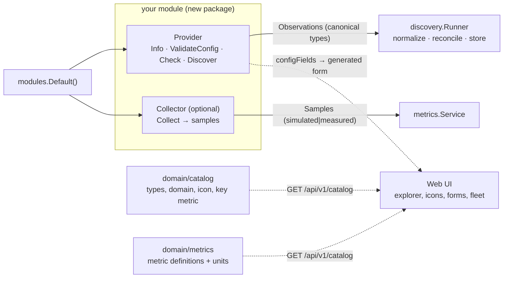

# Extending the platform: new domains, providers and database engines

**Audience:** engineers adding an integration. **Principle:** an integration is a *module*; API, store, scheduler and UI are driven by metadata and need no change (ADR 0012).

### Diagram X1 — where an integration plugs in
*Phase:* target design. *Evidence:* `internal/modules/modules.go`, `internal/app/app.go`, `internal/api/catalog.go`. *Legend:* solid = code dependency, dashed = metadata served to the UI.

## A. Add a database engine (for example MySQL)

1. Create `internal/dbengine/mysql/mysql.go` implementing `dbengine.Engine`:
   - `Open` builds a `*sql.DB` whose driver dials through the supplied `DialFunc` (most Go drivers accept a custom dialer; refuse drivers that cannot). Never put the password in a string that could be logged.
   - `Inventory`: server identity (`@@server_uuid`), version, schemas as `Databases`; tablespaces if meaningful.
   - `Sample`: gauges (`db.connections` from `Threads_connected`, `db.sessions.active` from `Threads_running`, `storage.used` per schema) and counters (`db.transactions.rate` from `Com_commit + Com_rollback`). Report only what the engine measures.
   - `MinimumPrivileges`: e.g. `PROCESS` and `SELECT` on `performance_schema`.
2. Unit-test with `dbengine/enginetest.Fake` (canned rows, fails on unexpected SQL). If a server can run locally, add an integration test like `TestPostgreSQLEndToEnd`.
3. Register it: add `mysql.Engine{}` to `modules.DatabaseEngines()`. The `engine` select in the UI, validation, discovery, metrics, the Databases view and the explorer's engine facet pick it up.
4. Record the driver in [../inventory/dependencies-and-licenses.md](../inventory/dependencies-and-licenses.md) (`make licenses`) and justify it under ADR 0008.

## B. Add a new domain or provider (for example a message broker)

1. **Types.** Register a domain and types in `internal/domain/catalog` (e.g. domain `messaging`; types `messaging.broker`, `messaging.topic` with icon keys and a key metric).
2. **Metrics.** Add definitions with UCUM-style units in `internal/domain/metrics/catalog.go` (`messaging.lag` `{message}`, …). Add simulated profiles if the module also has a fixture mode.
3. **Provider.** New package implementing `discovery.Provider`:
   - `Info()` with `ConfigFields` (use `Options` for closed sets, `Placeholder` for hints; never a secret field — secrets come from `credentialRef`).
   - `ValidateConfig` starts with `discovery.ValidateKnownFields` and checks hosts with `netguard.Policy.ValidateHost`/`ValidateURL`.
   - `Discover` emits pages of `topology.Observation` with a stable `Key{Provider, Scope, ExternalID}` (never a display name) and typed relationships; respect `ctx` cancellation.
4. **Collector (optional).** Implement `metrics.Collector`; map readings to resources by `ExternalID`; set `Source` honestly.
5. **Module.** Add a `modules.Func{...}` entry to `modules.Default()`.
6. **Tests.** `go test ./internal/modules/` fails if a declared type has no catalog entry, a key metric does not apply, or a provider advertising metrics has no collector. Add provider tests with an `httptest` server or fake.
7. **Docs.** Add the integration to the HLD capability table and, if it adds a dependency or a datastore, an ADR.

## C. Checklist before merging an integration

- [ ] Read-only: no write calls; least-privilege grants documented in `MinimumPrivileges`/description.
- [ ] Egress: hosts validated and dialled through `netguard`.
- [ ] Credentials only through `credentialRef`; error messages do not echo connection strings.
- [ ] Deterministic `ExternalID`s; relationships use canonical types; `contains`/`composed_of` stay acyclic.
- [ ] Bounded work: pagination or row caps, timeouts, retries only for idempotent reads.
- [ ] Data provenance: `simulated` vs `measured` set correctly.
- [ ] `make check` passes; OpenAPI unchanged unless the API changed (then `TestOpenAPIMatchesRouteTable` guides you).
