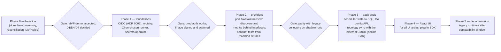

# Migration plan and capability traceability

## 1. Existing capabilities (F1–F24, verified in code by the PDF §4.1 and spot-checked) and their status

No legacy capability is removed by this work. "Preserved" means the legacy component continues to run unchanged.

| ID | Capability | Current owner (Verified) | MVP status | Gap / compatibility | Planned path |
|---|---|---|---|---|---|
| F1 | Collection jobs with schedules, run-now | job-scheduler | Preserved; MVP adds discovery jobs for its own slice (DB-backed, scheduled, run-now) | Different API (`/api/v1`) — legacy `/v1/job` unchanged | Phase 3: move scheduler state to SQL (pattern in ADR 0005) |
| F2 | Dispatch units, track per-unit state | job-fetcher | Preserved | — | Phase 2 hardening |
| F3 | Discover/collect AWS, Azure, GCP, Kubernetes | collectors | Preserved; MVP adds Kubernetes discovery + measured metrics adapter and fixture provider | AWS/Azure/GCP not in the MVP (private framework) | Phase 2: port each collector's discovery behind `discovery.Provider` |
| F4 | Forward results with batching/thresholds | result-processor | Preserved | MVP writes to its own store directly | Phase 2 |
| F5 | Buffer and replay (SNF), edge forwarding | store-and-forward | Preserved | — | Retained (PDF) |
| F6–F7 | Content packs; CLIs | content admin server and CLIs | Preserved | — | Phase 3 |
| F8–F10 | Diagram dashboards, push receiver, data collectors on the analytics DB | dashboard services | Preserved | — | Phases 3–4 (PDF) |
| F11–F13 | UI plug-in registry, plug-ins, roles/groups | explore service | Preserved | MVP roles are separate (dev auth) | Phase 1: shared OIDC; Phase 4: React shell |
| F14 | SSO, local login | dashboard web, Java filters | Preserved | MVP uses dev auth only | ADR 0006 OIDC |
| F15–F17 | PDF export, content zips, aging/licence | dashboard services | Preserved | — | Phase 3 |
| F18–F19 | Monitor configuration, downtime, scripts | Java gateways | Preserved | — | Phase 3 (Go Monitoring Config API) |
| F20–F21 | Page generation, publishing | page-creator, publish.py | Preserved | — | Phase 3 |
| F22 | Localization | l10n folders | Preserved | MVP UI is English only | Phase 4: react-i18next reading existing JSON |
| F23 | Multi-tenant isolation | schema + routes | Preserved; **implemented** in the MVP (tenant from credential, all queries scoped) | — | — |
| F24 | Edge installation profile | monitoring-service-edge chart | Preserved | MVP chart has no edge profile | Phase 5 |

## 2. New MVP capabilities (M1–M12) → code → tests

| ID | Capability | Code | Proven by |
|---|---|---|---|
| M1 | Connection profiles, secret-safe | `api/connections.go`, `secrets` | E2E validation cases; `TestSecretReferences` |
| M2 | Discovery jobs with idempotency, lease, cancel, recovery, schedule | `discovery/runner.go`, `store/postgres` | `TestJobLifecycle…`, `TestClaimIsExclusive…`, `TestRecoverExpiredJobs`, `TestCancelAndFailure…` |
| M3 | Provider interface, fixture, Kubernetes adapter | `discovery/**`, `kubeclient` | fixture and Kubernetes contract tests |
| M4 | Normalized topology and reconciliation | `domain/topology`, `store/postgres/topology.go` | domain tests; `TestApplySnapshotReconciliationEndToEnd`; E2E drift |
| M5 | Topology-driven metrics with provenance | `domain/metrics`, `metrics/**` | metrics tests; E2E series; smoke |
| M6 | Versioned API, OpenAPI, errors, pagination, health | `api`, `httpx`, `contracts` | `TestOpenAPIMatchesRouteTable`; E2E error model |
| M7 | React UI | `web/src` | Vitest; browser check (verification.md) |
| M8 | Auth boundary and tenant scoping | `auth`, `api/api.go` | `TestDevAuthenticator`; E2E isolation |
| M9 | Local run, image, chart, CI | `Makefile`, `scripts`, `deploy`, `.github` | `make demo` smoke; Helm lint/render |
| M10 | Generic database integration (PostgreSQL, Oracle) | `dbengine/**`, `discovery/database`, `metrics/dbmetrics` | `TestPostgreSQLEndToEnd`, `TestDialTimeGuard`, Oracle engine tests; smoke |
| M11 | Modules and resource-type catalog | `modules`, `domain/catalog`, `api/catalog.go` | `TestDefaultInstallsAndIsConsistent`, `TestInstallRejectsMiswiring`; E2E catalog |
| M12 | Explorer UX (facets, fleet, palette, time range, theme, generated forms) | `web/src`, `GET /resources/facets`, `GET /fleet` | E2E facets/fleet; Vitest Explorer, CommandPalette, Connections form, Databases |

## 3. Phases

### Diagram P2 — migration phases and gates
*Phase:* planning. *Evidence:* PDF §11 phases, adjusted for what the MVP delivered. *Assumption:* sequencing and gates require stakeholder approval (D1, D4, D6, D7 open).

| Phase | Exit criteria |
|---|---|
| 0 | `make demo` passes on a clean checkout; docs reviewed |
| 1 | OIDC implemented and pen-tested; dev auth disabled in all shared environments |
| 2 | Each ported provider passes contract tests against recorded fixtures and a shadow comparison with the legacy collector |
| 3 | Decision on topology system of record (external CMDB vs platform); dual-write or sync verified |
| 4–5 | Per PDF §11, with the compatibility window from decision D7 |

## 4. Unavoidable behaviour differences in the MVP

- New API paths under `/api/v1` of the new service; no legacy path is served or changed.
- Topology is stored in the platform, not the external CMDB; nothing is written to it.
- Simulated data is clearly labelled and never mixed with measured data for the same connection (each provider has exactly one collector).
