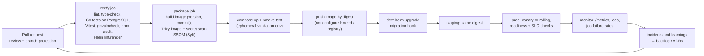

# SDLC and CI/CD

## Existing versus new (Verified)

| Stage | Exists today (legacy) | Added for `platform/` |
|---|---|---|
| Source and review | 33 repositories; CODEOWNERS/MR templates in some | Single `platform/` tree; **Recommendation:** branch protection on `main` requiring the `platform-ci` checks and one review (configured outside the repo) |
| Build | Jenkins per repository; Maven, Makefiles, Grunt, Nx | `make build` (Go + Vite), `make docker-build` |
| Static checks | Commercial SAST scanner, Sonar | `make lint` (gofmt, go vet, ESLint), `make typecheck` |
| Tests | 344 Go, 95 Java, 723 TS, ~258 Cypress files | `make test` (Go unit/contract/integration on real PostgreSQL with `-race`; Vitest) |
| Security scanning | Commercial SAST scanner | `make vuln` (govulncheck, npm audit), Trivy image + secret scan, Syft SBOM in CI; `make sbom` offline |
| Packaging | Docker + Helm per service, internal artifact repository | One image, one chart; registry is your choice (PDF D14: Harbor) |
| Deploy | Umbrella chart | Helm with overlays; migration hook |

The workflow `.github/workflows/platform-ci.yml` is new and covers only `platform/`; it does not duplicate or replace the legacy Jenkins pipelines. CI tool choice (Jenkins vs GitLab vs GitHub) is open (PDF D4); every step is a Makefile target so any runner can execute it.

## Diagram P1 — CI/CD and SDLC flow
*Phase:* SDLC. *Evidence:* `Makefile`, `.github/workflows/platform-ci.yml`. *Assumption:* environments named dev/staging/prod; promotion and canary steps are Recommendations (not automated in this repository).

## Stage details

1. **Change review.** PR with CI green, one reviewer; ADR for architectural changes; decision log updated.
2. **Format, lint, type, unit.** `make lint typecheck test`.
3. **Integration, contract, migration, end-to-end.** Included in `make test` (PostgreSQL service container in CI) and the compose smoke step.
4. **Dependency, licence, secret, image scanning.** `make vuln`; Trivy (image: CRITICAL/HIGH fail; secret scan); `make licenses` regenerates the inventory — **Recommendation:** fail CI on licences outside an allow-list (MIT, BSD, Apache-2.0, ISC, MPL-2.0 for unmodified dev tools).
5. **Immutable artifacts.** Image tagged with version and commit, labels `org.opencontainers.image.*`; SBOM attached as a CI artifact. **Recommendation:** sign with cosign and push by digest.
6. **Ephemeral validation.** Compose environment in CI; for Kubernetes, a kind cluster with `values-dev.yaml` (**Recommendation**).
7. **Promotion.** Same digest through environments; config and secrets external.
8. **Migrations before rollout.** Helm pre-upgrade hook; backward compatible (expand/contract).
9. **Canary/rolling and health verification.** Rolling by default; rollback triggers in [deployment.md](deployment.md#rollout-rollback-and-failure-handling).
10. **Monitor and feed back.** Platform metrics and logs; incidents produce backlog items and ADR updates.

## What ran in this workspace

See [../verification.md](../verification.md). The GitHub Actions workflow itself was **not executed** here (no remote runner); its steps were run locally through the same Makefile targets where tooling allowed.
