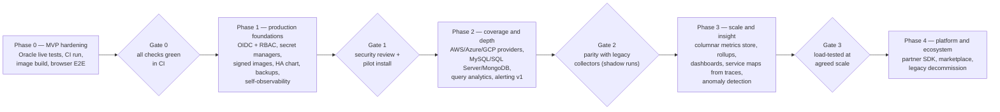

# Product roadmap: from MVP to a production observability product

**Status:** Proposal for review. Sequencing is a recommendation; dates, staffing, pricing and customer commitments are **not** set here because no evidence for them exists in the repository. Each phase ends with an exit gate that must be demonstrated, not asserted. Gap IDs (G…) refer to [assessment/mvp-gap-review.md](assessment/mvp-gap-review.md); legacy phases refer to [migration/plan-and-traceability.md](migration/plan-and-traceability.md).

### Diagram R1 — roadmap phases and gates
*Phase:* planning. *Evidence:* gap review and migration plan in this repository. *Legend:* boxes = phases, diamonds = exit gates. *Assumption:* order may change once open questions Q1–Q6 are answered.

## Phase 0 — MVP hardening (close "Open – MVP" gaps)

| Item | Gap | Done when |
|---|---|---|
| Run the CI `oracle-store` job (platform store + monitoring engine on Oracle Free 23ai); add 19c and non-CDB targets | G10, G20b | Verification record shows Oracle inventory and metrics from a live server |
| Execute the GitHub Actions workflow; build, scan and SBOM the image | G11, G12 | Green pipeline run linked from verification.md |
| Playwright E2E: sign-in, explorer facets, palette, add database, topology | G13 | Suite runs in CI against the compose stack |

## Phase 1 — production foundations

| Theme | Items |
|---|---|
| Identity & access (G14) | OIDC with PKCE for the UI and JWT validation for the API; role mapping from IdP groups; RBAC admin UI; audit of permission changes; SCIM (optional) |
| Secrets (G15) | Secret providers: HashiCorp Vault, AWS Secrets Manager, Azure Key Vault, GCP Secret Manager, Kubernetes Secrets via CSI; rotation without restart |
| Supply chain (G23) | cosign signatures, SLSA provenance, SBOM attestation; admission policy example (Kyverno/Gatekeeper) |
| Reliability (G21) | Helm HA profile (≥ 2 API, ≥ 2 workers, PDBs, anti-affinity), PostgreSQL HA via managed service or CloudNativePG, backup/restore drills with measured RPO/RTO |
| Self-observability (G22) | OpenTelemetry traces for API, jobs and collectors; shipped dashboards and alerts for the platform; SLOs for the platform itself once targets are agreed (Q2) |
| Tenancy | Per-tenant quotas and rate limits; tenant lifecycle (create, suspend, export, delete) |

## Phase 2 — coverage and depth

| Theme | Items |
|---|---|
| Cloud providers (G16) | Port AWS, Azure, GCP discovery and metrics from the legacy collectors behind `discovery.Provider`/`metrics.Collector`, one module each; contract tests from recorded responses; shadow comparison with legacy |
| Databases (G17) | Engines: MySQL/MariaDB, SQL Server, MongoDB (document model mapped to `database.*`); query analytics: normalized statements (literals stripped before storage), top queries, wait events, blocking chains, explain plans on demand; replication/HA topology edges |
| Alerting v1 (G18) | Threshold and absence rules on any catalog metric, notification channels (email, webhook, Slack, PagerDuty), maintenance windows, alert history; rules scoped by topology ("all tablespaces under ERP"), which is the platform's differentiator |
| Kubernetes depth | Workloads (StatefulSet, DaemonSet, Job), events, owner references as edges |
| Platform store on Oracle (G20b) | Implemented in the MVP (ADR 0011). Remaining: certify on 19c and Autonomous Database, RAC failover test, array-bound bulk writes, Oracle-specific backup runbook drill |

## Phase 3 — scale and insight

| Theme | Items |
|---|---|
| Data tier (G19) | Metrics behind `store.Metrics` move to a columnar store (ClickHouse) with rollups (1 m → 1 h → 1 d) and tiered retention; PostgreSQL keeps topology and jobs |
| Dashboards & views (G25) | Saved explorer views, custom dashboards, shareable links with access control, PDF export (legacy F15 parity) |
| Correlation | Topology-aware correlation: show metric anomalies along `depends_on`/`routes_to` paths; change events from discovery on charts |
| Traces & logs | OTLP ingestion; service maps derived from traces merged with discovered infrastructure topology |
| Anomaly detection | Seasonal baselines per metric with explainable bands; opt-in per tenant |

## Phase 4 — platform and ecosystem

| Theme | Items |
|---|---|
| Extensibility | Out-of-process partner SDK (gRPC) with signed integrations; integration marketplace; versioned catalog API |
| Legacy (G26) | Migrate remaining F1–F24 capabilities and decommission legacy runtimes after the compatibility window (decision D7) |
| Compliance (G24) | Only after evidence exists: audit export, data-residency controls, and certifications chosen by the business |
| UX | i18n using the existing localization assets; full accessibility audit; mobile-friendly incident views |

## Production-readiness checklist (applies to every release)

- [ ] All Gate criteria for the current phase demonstrated in CI and recorded in `docs/verification.md`
- [ ] No critical/high vulnerabilities in image and dependency scans, or documented exceptions with expiry
- [ ] Database migrations forward-only, tested on a copy of production-sized data, with rollback plan
- [ ] Backups restored successfully within the agreed RTO in the last 30 days
- [ ] Runbook updated; on-call trained; alerts for the platform itself firing in staging
- [ ] Security review of new integrations (egress, credentials, read-only grants)

## Open questions (need stakeholder answers)

| ID | Question | Affects |
|---|---|---|
| Q1 / Q-DB1 | Which Oracle versions and deployment forms (19c, 23ai, Autonomous, RAC, Exadata) must the platform store be certified on? | ADR 0011 certification scope |
| Q2 | Target scale: tenants, resources per tenant, metric samples per second, retention | Phase 3 data tier; load tests |
| Q3 | Availability and recovery targets (SLO, RPO, RTO) | Phase 1 HA design |
| Q4 | Which identity providers must be supported first? | Phase 1 OIDC |
| Q5 | Priority order of cloud providers and database engines | Phase 2 sequencing |
| Q6 | Is query-text collection acceptable to customers, and under what masking policy? | Phase 2 query analytics |
