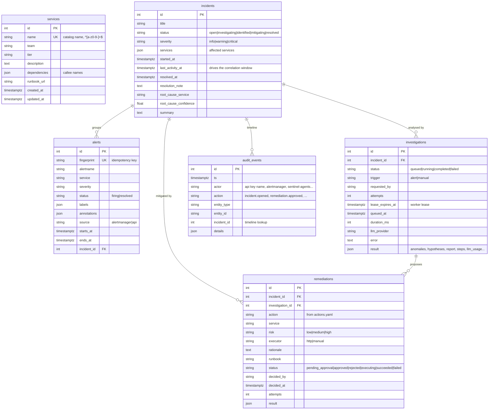

# Data model

Source of truth: `sentinel/src/sentinel/infrastructure/orm.py` and the Alembic migrations in
`sentinel/src/sentinel/migrations/versions/`. A test (`tests/integration/test_migrations.py`) fails
if the two drift apart; CI also runs `alembic check` against PostgreSQL.



## Design notes

* **Timestamps** are `timestamptz`, stored and returned in UTC (`UTCDateTime` type decorator keeps
  SQLite tests honest).
* **JSON vs columns**: anything filtered or sorted by the API (`status`, `service`, `severity`,
  `incident_id`) is a column with an index. Agent output (`investigations.result`) is JSONB so its
  schema can evolve without migrations. The current shape is produced by
  `sentinel.agents.graph.serialize()`.
* **Queue indexes**: `ix_investigations_status_queued (status, queued_at)` supports the claim query.
* **Deletes**: incidents cascade to investigations/remediations; alerts are detached (`SET NULL`)
  so raw alert history survives incident clean-up.
* **Audit** is append-only by convention: the application never updates or deletes `audit_events`.
  In production, grant the app role `INSERT, SELECT` only on that table.

## `investigations.result` (abridged)

```json
{
  "window": {"start": 1794251000.0, "split": 1794252500.0, "end": 1794252800.0},
  "scope": ["frontend", "checkout", "inventory", "payments"],
  "evidence_ok": true,
  "signals_with_data": 12,
  "anomalies": [{"service": "payments", "kind": "error_rate", "score": 9.8, "severity": 0.74,
                 "baseline": 0.05, "observed": 0.163, "onset_ts": 1794252473.0,
                 "method": "static_threshold", "description": "..."}],
  "correlation": {"propagation": ["payments", "checkout", "frontend"],
                  "silent_anomalies": [], "blast_radius": ["checkout", "frontend", "payments"]},
  "hypotheses": [{"service": "payments", "cause": "error_rate", "score": 0.80, "confidence": 0.68,
                  "components": {"anomaly": 0.74, "topology": 1.0, "traces": 1.0,
                                 "earliness": 1.0, "logs": 0.33},
                  "evidence": ["...", "12 error span(s) originate here across 12 sampled traces"]}],
  "recommendations": [{"action": "disable_fault_flag", "service": "payments", "risk": "low",
                       "executor": "http", "requires_approval": true, "runbook": "high-error-rate"}],
  "narrative": "The most likely root cause is **payments** ...",
  "summary": "CRITICAL incident affecting checkout, frontend, payments ...",
  "report": "# Incident #1 ...",
  "data_gaps": [],
  "steps": [{"agent": "telemetry_analysis", "duration_ms": 170, "summary": "...", "ok": true}],
  "llm_usage": [{"task": "rca_narrative", "provider": "deterministic", "fallback": false,
                 "input_tokens": 0, "output_tokens": 0, "prompt_version": "2026-11-01"}]
}
```

## Backup and retention

| Data | Retention | Backup |
|---|---|---|
| PostgreSQL (incidents, audit) | Indefinite (audit is evidence) | Managed PITR (7-35 days) + daily logical dump; restore tested quarterly - see [DEPLOYMENT_GUIDE.md](../../DEPLOYMENT_GUIDE.md#8-backup-and-disaster-recovery) |
| Prometheus | 7 days local (`--storage.tsdb.retention.time`) | Not backed up; add Thanos/Mimir for long-term |
| Loki | 168 h (`retention_period`) | Object storage lifecycle policy in prod |
| Tempo | 72 h (`block_retention`) | Object storage lifecycle policy in prod |
