# Architecture diagrams

All diagrams are [Mermaid](https://mermaid.js.org/) and render natively on GitHub. Edit the
text, not exported images. Each diagram reflects code that exists in this repository; the
"Source of truth" line names the files to check when updating it.

| # | Diagram | Audience |
|---|---|---|
| 1 | [High-level architecture](#1-high-level-architecture) | Everyone |
| 2 | [Component architecture](#2-component-architecture) | Architects, developers |
| 3 | [Service interaction](#3-application-and-service-interaction) | Developers, SRE |
| 4 | [End-to-end data flow](#4-end-to-end-data-flow) | Architects, data/platform engineers |
| 5 | [Agent orchestration](#5-ai-agent-orchestration-and-execution-flow) | AI engineers |
| 6 | [AIDLC workflow](#6-aidlc-workflow) | Delivery leads, FDEs |
| 7 | [Sequence diagrams](#7-sequence-diagrams-for-critical-use-cases) | Developers |
| 8 | [Deployment architecture](#8-deployment-architecture) | Platform/SRE |
| 9 | [CI/CD pipeline](#9-cicd-pipeline) | Developers, release managers |
| 10 | [Observability architecture](#10-observability-and-monitoring-architecture) | SRE |
| 11 | [Security & authentication flow](#11-security-and-authentication-flow) | Security reviewers |

---

## 1. High-level architecture

Source of truth: `deploy/compose/docker-compose.yml`.

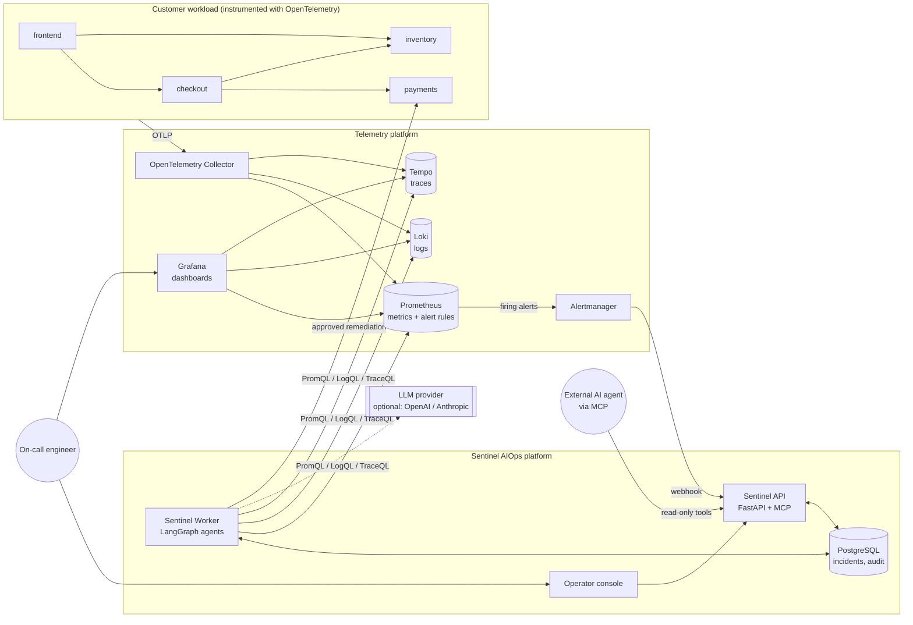

## 2. Component architecture

Source of truth: `sentinel/src/sentinel/` package layout.

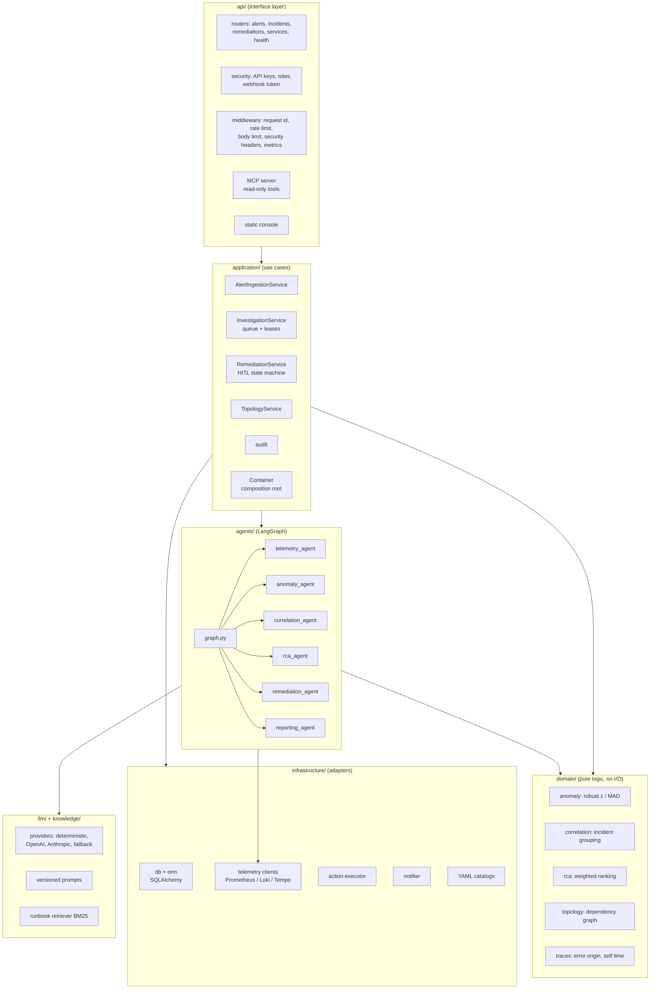

Dependency rule: arrows point inward. `domain/` imports nothing from other layers, so it is
unit-tested without mocks.

## 3. Application and service interaction

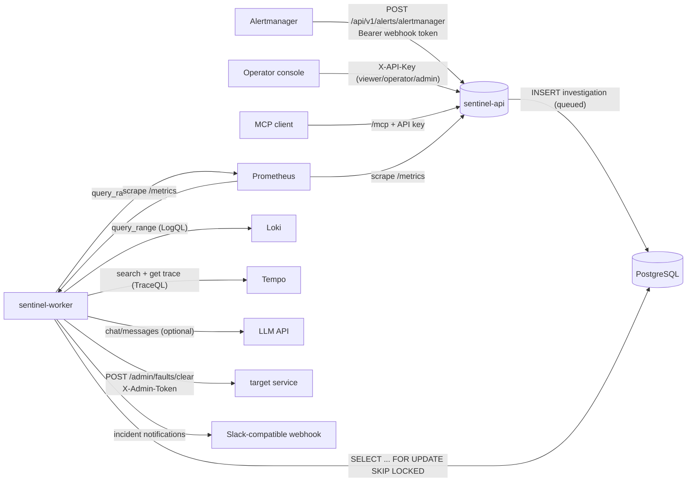

## 4. End-to-end data flow

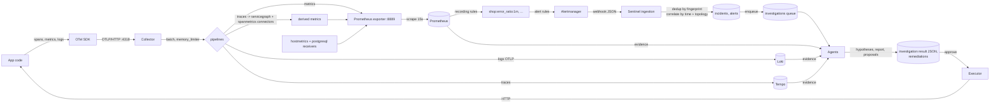

## 5. AI agent orchestration and execution flow

Source of truth: `sentinel/src/sentinel/agents/graph.py`.

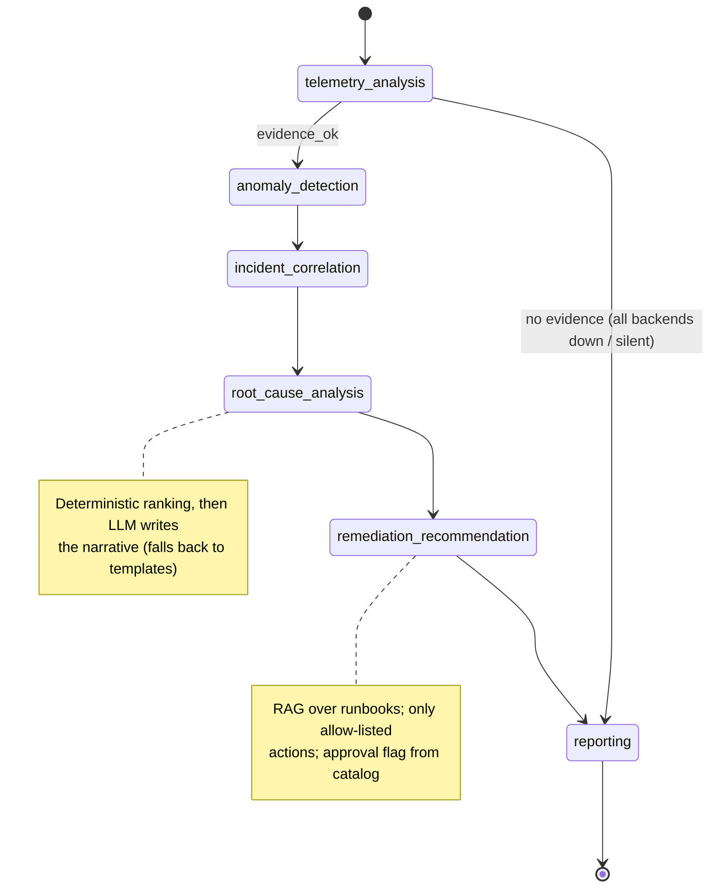

After the graph: proposals are persisted as `pending_approval` and wait for a human.

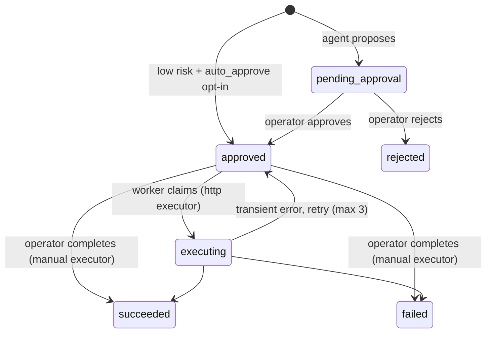

## 6. AIDLC workflow

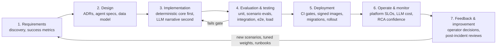

## 7. Sequence diagrams for critical use cases

### 7a. Alert to identified root cause (UC-02, UC-03)

```mermaid
sequenceDiagram
  autonumber
  participant P as Prometheus
  participant AM as Alertmanager
  participant API as Sentinel API
  participant DB as PostgreSQL
  participant W as Worker
  participant T as Prometheus/Loki/Tempo
  participant L as LLM (optional)
  P->>AM: HighErrorRate{service=checkout} firing
  AM->>API: POST /api/v1/alerts/alertmanager (Bearer token)
  API->>DB: advisory lock; upsert alert by fingerprint
  API->>DB: correlate (window + topology) -> open/join incident
  API->>DB: enqueue investigation (if none queued/running)
  API-->>AM: 200 {incidents_opened:[42]}
  W->>DB: claim job (FOR UPDATE SKIP LOCKED, lease)
  W->>T: golden signals, error logs, error/slow traces
  W->>W: anomaly -> correlation -> RCA ranking
  W->>L: narrative + summary (evidence as delimited data)
  L-->>W: text (or fallback to templates)
  W->>DB: result, root cause, remediation proposals, audit
```

### 7b. Human-approved remediation (UC-04)

```mermaid
sequenceDiagram
  autonumber
  actor O as Operator
  participant API as Sentinel API
  participant DB as PostgreSQL
  participant W as Worker
  participant S as payments service
  O->>API: POST /remediations/7/approve (X-API-Key, role >= operator)
  API->>DB: pending_approval -> approved; incident -> mitigating; audit(actor)
  W->>DB: claim approved http remediation -> executing
  W->>W: validate action in catalog, service in catalog
  W->>S: POST /admin/faults/clear (X-Admin-Token)
  S-->>W: 200 {cleared:true}
  W->>DB: executing -> succeeded; audit
  Note over S,API: error rate drops -> alerts resolve -> incident auto-resolves
```

## 8. Deployment architecture

Source of truth: `deploy/k8s/`.

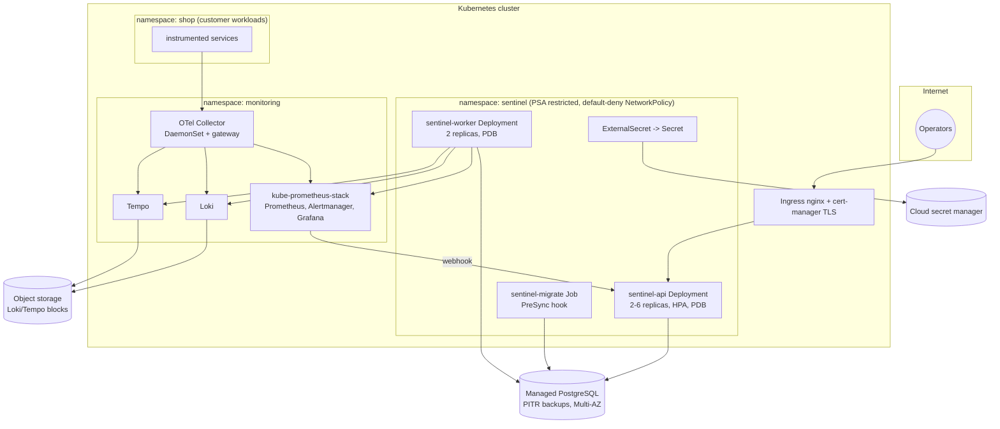

## 9. CI/CD pipeline

Source of truth: `.github/workflows/ci.yml`, `.github/workflows/release.yml`.

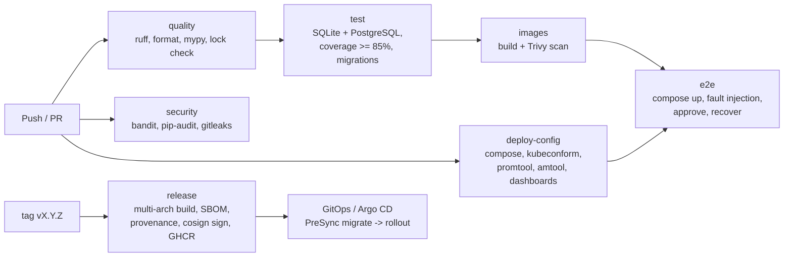

## 10. Observability and monitoring architecture

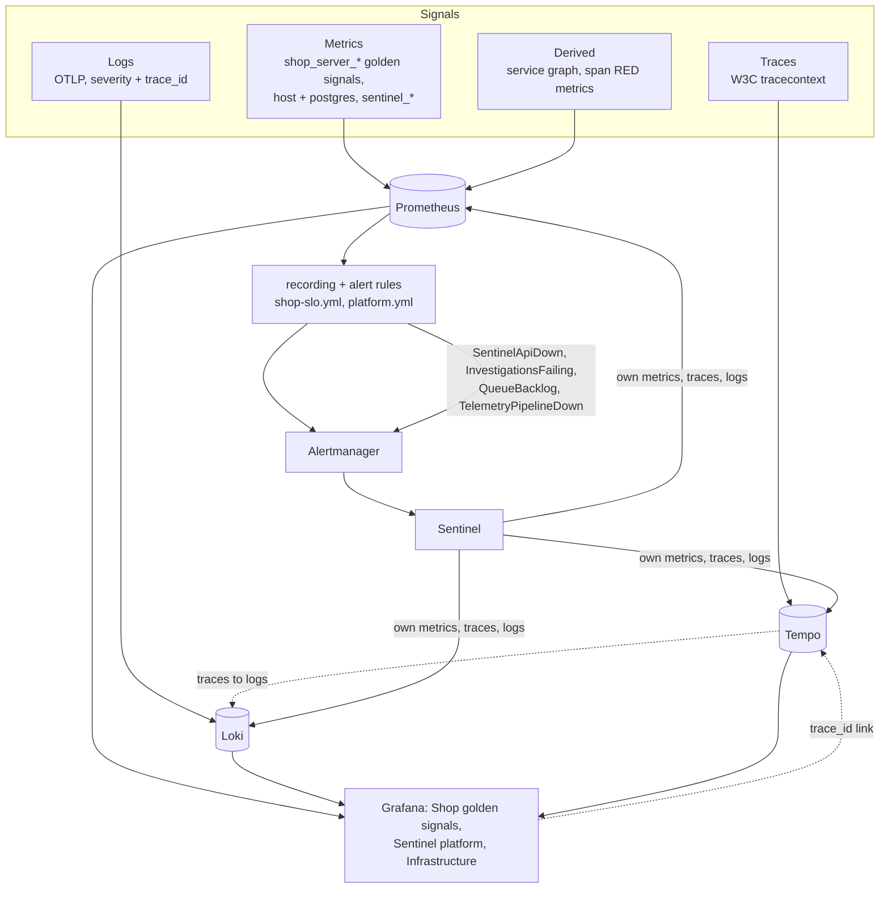

Sentinel is itself observable: if Sentinel or the pipeline breaks, Prometheus alerts on it
(the `platform` rule group) independently of Sentinel.

## 11. Security and authentication flow

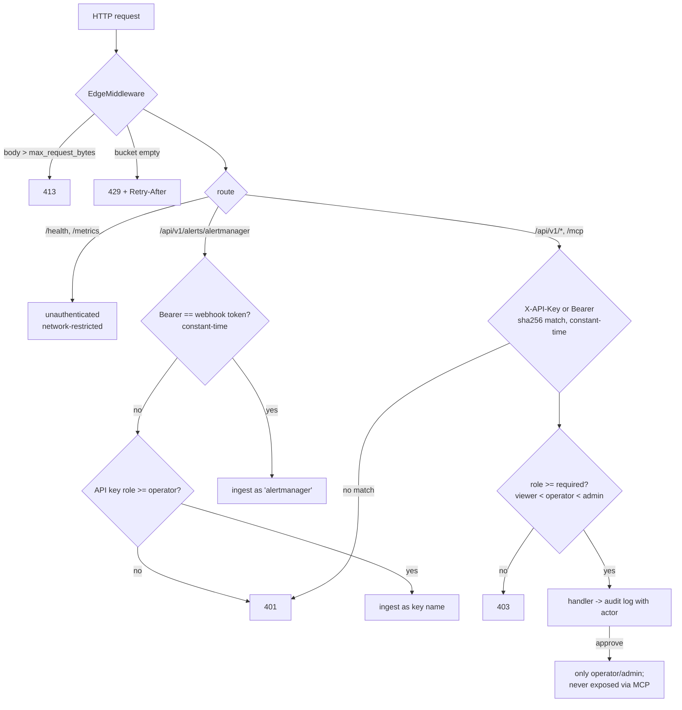
