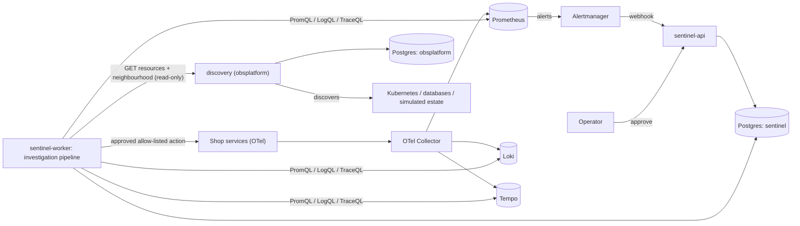

# Unified platform guide: Sentinel + discovery

A step-by-step guide to the unified observability platform: what each part does, how to run
them alone and together, how to check that the connection works, and what is still needed
before production.

**Applies to:** the repository after the 2026-11-24 unification ([ADR-0009](../adr/0009-unify-around-sentinel.md)).
**Status labels:** **Verified** means it was run while building this, and the command and result
are given. **Not verified** means it needs an environment that was not available (Docker daemon,
Kubernetes cluster).

---

## 1. What the unified platform is

Before the unification there were two unrelated products. There is now one platform with one
entry point:

| Component | Folder | Language | Job |
|---|---|---|---|
| **Sentinel** (the core) | [`sentinel/`](../../sentinel/) | Python | Turns alerts into one incident, investigates with a fixed agent pipeline, ranks root causes, proposes allow-listed fixes, waits for human approval, executes, audits |
| **Discovery** | [`discovery/`](../../discovery/) | Go + React | Discovers infrastructure (Kubernetes, databases, a simulated estate), keeps a reconciled topology, collects metrics |
| Telemetry stack | [`deploy/compose/`](../../deploy/compose/) | config | OTel Collector, Prometheus, Alertmanager, Loki, Tempo, Grafana |
| Demo workload | [`demo-services/`](../../demo-services/) | Python | Four instrumented shop services with an admin fault API |

**How they connect.** Sentinel asks discovery, read-only, "what infrastructure is under this
service?" during every investigation. The answer appears as an **Infrastructure context**
section in the incident report and in the RCA narrative's evidence. It does **not** change the
root-cause ranking. Ranking weights change only through the evaluation set
([agentic guide §8.2](agentic-engineering-guide.md#82-evaluation-datasets-and-expected-behaviour-proposed)).



**The investigation pipeline now has seven steps:**

```
telemetry_analysis -> infrastructure_context -> anomaly_detection -> incident_correlation
  -> root_cause_analysis -> remediation_recommendation -> reporting
```

`infrastructure_context` ([`agents/infrastructure_agent.py`](../../sentinel/src/sentinel/agents/infrastructure_agent.py)):

1. For each service in scope (up to 15), it finds resources whose **name equals** the service
   name and whose type is in `SENTINEL_DISCOVERY_SERVICE_TYPES` (default
   `k8s.deployment,k8s.service`).
2. For each match, it reads the bounded neighbourhood: depth 2, both directions, at most 50
   nodes, including missing resources.
3. It flags resources that are `missing` (no longer observed) or `stale` (not re-observed
   recently).
4. If discovery is not configured, the step is skipped quietly. If discovery is down, it records
   a data gap and the investigation carries on.

## 2. Repository layout after the unification

```
sentinel/          Agentic incident engine (core product)
discovery/         Discovery and topology service (was observability-platform/)
demo-services/     Instrumented demo workload
deploy/compose/    One local stack for everything; discovery is the "discovery" profile
deploy/k8s/        Sentinel Kustomize base + overlays (discovery ships its own Helm chart)
docs/              ADRs, guides (this one), agents, use cases, runbooks, testing
handbook/          Learning track 000-012 that leads into Sentinel
.github/workflows/ ci.yml (Sentinel), discovery-ci.yml (discovery), release.yml
_archive/          Git-ignored: removed items for manual deletion (see MANIFEST.md)
```

## 3. Prerequisites

| Tool | Needed for | Notes |
|---|---|---|
| Docker 24+ with Compose v2, about 5 GB RAM free | Full stack | About 4 GB for the default stack, plus about 0.5 GB for discovery |
| Python 3.12 and [uv](https://docs.astral.sh/uv/) | Sentinel development and tests | `cd sentinel && uv sync --extra dev` |
| Go 1.27, Node 22+ | Discovery development | `go.mod` pins the toolchain |
| PostgreSQL 16+ binaries (optional) | Discovery demo without Docker | `initdb`, `pg_ctl` and `psql` on PATH |
| kubectl (optional) | Rendering the Kubernetes manifests | `make k8s-render` |

## 4. Step by step

### Step 1: Run Sentinel's tests (no Docker needed)

```bash
cd sentinel && uv sync --extra dev
```

```bash
make lint
```

```bash
make test
```

**Verified (2026-11-24):** ruff, ruff format and mypy are clean, and pytest shows `92 passed`.
That includes 7 HTTP-client tests (`tests/unit/test_discovery.py`) and 3 pipeline tests for the
infrastructure step (`tests/unit/test_agents.py`).

### Step 2: Run discovery's tests (no Docker needed)

```bash
cd discovery/platform && go build ./... && go vet ./... && go test ./...
```

Or run `make discovery-test` from the repository root (Go and web).

**Verified:** `go build`, `go vet` and `go test ./...` pass after the folder rename. The Go module
path (`github.com/deeprajsshetty/observability-platform/platform`) is unchanged on purpose: Go
import paths do not depend on the folder name.

### Step 3: Start the default stack and run the core use case

```bash
make up
```

Wait about 2 minutes for a traffic baseline, then inject a fault:

```bash
make demo-errors
```

Open <http://localhost:8000> and sign in with an API key from `deploy/compose/.env.keys`.
Within about 90 seconds an incident shows root cause `payments`. Approve `disable_fault_flag`
and watch the error rate fall in Grafana (<http://localhost:3000>). The infrastructure step
reports `discovery not configured; skipped`, which is expected at this step.

**Not verified here:** there was no Docker daemon during this change. The default stack's
Compose file is unchanged apart from two empty environment variables, and
`docker compose config` validates it.

### Step 4: Add the discovery service

```bash
make down
```

```bash
make up-discovery
```

This target starts the same stack plus the `discovery` profile: `discovery-db`,
`discovery-migrate`, `discovery-seed` and `discovery`. It also sets
`SENTINEL_DISCOVERY_URL=http://discovery:8080` and `SENTINEL_DISCOVERY_TOKEN=dev-viewer` for the
Sentinel containers.

Check the discovery API:

```bash
curl -s -H "Authorization: Bearer dev-viewer" "http://localhost:8090/api/v1/resources?limit=5" | python3 -m json.tool
```

Then run a discovery job so the topology has data. Open <http://localhost:8090>, sign in with
`dev-admin`, go to *Connections*, open *Demo estate (simulated)*, and click *Run discovery*.

**What to expect in Compose.** The seeded estate is a *simulated cloud* (VPCs, instances, pods
named `ingest-1`, databases such as `orders-db-east`). It does not contain resources named
`frontend`, `checkout`, `payments` or `inventory`. So in Compose the infrastructure step reports
`0 service(s) mapped to infrastructure, N without a discovered resource`. That confirms the two
services can talk to each other, but it does not produce real context. Real context comes from a
Kubernetes connection (Step 6).

**Verified (2026-11-24), without Docker:** the discovery demo (`scripts/demo.sh` with
`OBS_HTTP_ADDR=127.0.0.1:8090`, local PostgreSQL 18) printed `SMOKE PASS` with 42 resources and
80 relationships. Sentinel's real client, `HttpDiscoverySource`, was then run against it:

| Service name queried | Types | Result |
|---|---|---|
| `ingest-1` | `k8s.pod` | matched 1 pod; neighbours included `k8s.node analytics-node-1`, `k8s.cluster analytics`, `database.instance orders-db-west`, `network.subnet subnet-west-b` |
| `i-east-api-01` | `compute.instance` | matched 1 instance; neighbours included `cache.cluster session-cache-east`, `database.instance orders-db-east` |
| `payments` | both | no match, so empty evidence (correct for the simulated estate) |

**Not verified here:** the `discovery-*` Compose services themselves, because there was no Docker
daemon. `docker compose --profile discovery config` validates them.

### Step 5: See infrastructure context in a report

With Step 4 running, trigger `make demo-errors`, open the incident, then *Report*. When services
map to resources, the report includes a section like this one, from the unit-test fixture:

```markdown
## Infrastructure context
From the discovery service. Context only; it does not change the ranking.

| Service | Resources | Issues |
|---|---|---|
| payments | 1 database.instance, 1 k8s.deployment, 1 k8s.pod | database.instance payments-db is missing (no longer observed by discovery) |
```

The RCA narrative adds a matching sentence ("Infrastructure context: database.instance payments-db
is missing ..."). The investigation JSON (`GET /api/v1/investigations/{id}`) has an
`infrastructure` array with the matched and neighbouring resources.

### Step 6: Map services on Kubernetes (where the context becomes real)

Discovery's Kubernetes provider discovers nodes, namespaces, deployments, pods and services. It
derives relationships from placement, owners and selectors. When your shop runs on Kubernetes as
Deployments named `frontend`, `checkout`, `payments` and `inventory`, the default
`SENTINEL_DISCOVERY_SERVICE_TYPES=k8s.deployment,k8s.service` maps them with no extra config.

1. Install discovery with its Helm chart. Read
   [discovery/docs/operations/deployment.md](../../discovery/docs/operations/deployment.md) first.
   On a throwaway evaluation cluster, use `values-dev.yaml`.
2. Create a Kubernetes connection in discovery (UI → *Connections* → *Add*). It uses a read-only
   ClusterRole, and the token is a secret **reference**, never a value.
3. Run discovery once. Then check that `GET /api/v1/resources?type=k8s.deployment&q=payments`
   returns your deployment.
4. In Sentinel's config, set `SENTINEL_DISCOVERY_URL`. In `sentinel-secrets`, set
   `SENTINEL_DISCOVERY_TOKEN`. Commented examples are in
   [`deploy/k8s/base/configmap.yaml`](../../deploy/k8s/base/configmap.yaml).
5. Allow egress from Sentinel to discovery's namespace on port 8080 in
   [`deploy/k8s/base/networkpolicy.yaml`](../../deploy/k8s/base/networkpolicy.yaml). Without this
   rule, every lookup becomes a data gap.

**Not verified:** discovery's Kubernetes provider is contract-tested against recorded API shapes,
but has never run against a live cluster (see its README). The same applies to this step end to end.

### Step 7: Work on each part

| Task | Sentinel | Discovery |
|---|---|---|
| Lint | `make lint` | `make discovery-lint` |
| Tests | `make test` | `make discovery-test` |
| Run locally | `make up` | `cd discovery && make demo` (port 8080; set `OBS_HTTP_ADDR=127.0.0.1:8090` if the shop uses 8080) |
| CI | `.github/workflows/ci.yml` | `.github/workflows/discovery-ci.yml` (path-filtered to `discovery/**`) |
| Contract | `sentinel/src/sentinel/infrastructure/discovery.py` | `discovery/platform/contracts/openapi.yaml` (`/api/v1/resources`, `/api/v1/resources/{id}/neighborhood`) |

When the discovery API contract changes, update both sides together, and run
`tests/unit/test_discovery.py` plus a live check like the one in Step 4.

## 5. Configuration reference (Sentinel side)

| Variable | Default | Meaning |
|---|---|---|
| `SENTINEL_DISCOVERY_URL` | unset | Base URL of the discovery service. Unset or empty disables the step. |
| `SENTINEL_DISCOVERY_TOKEN` | empty | Bearer token. Viewer role is enough (`topology:read`). |
| `SENTINEL_DISCOVERY_SERVICE_TYPES` | `k8s.deployment,k8s.service` | Resource types that stand for an application service (exact name match) |
| `SENTINEL_DISCOVERY_DEPTH` | 2 (1–4) | Neighbourhood depth |
| `SENTINEL_DISCOVERY_MAX_NODES` | 50 (1–500) | Neighbourhood size cap; the report marks truncation |
| `SENTINEL_DISCOVERY_TIMEOUT_S` | 5.0 | Per-request timeout (one retry on 5xx or transport errors) |

## 6. Security boundaries of the integration

| Concern | Control |
|---|---|
| Sentinel changing infrastructure through discovery | Impossible by construction: the client only sends `GET` requests (asserted in tests). Connection, job and collection endpoints are never called. |
| Query injection through service names | Names must match `SERVICE_NAME_RE` before they reach a query string (test `test_refuses_unsafe_service_name`) |
| Path injection through returned IDs | IDs must match `^[A-Za-z0-9_-]{1,128}$` before they are used in a URL path (test drops `../../admin`) |
| Untrusted resource names | Treated as data: escaped in report tables, and sent to the LLM only inside `<evidence>` delimiters, with output that is display-only |
| Discovery steering remediation | Not possible. Infrastructure context does not affect ranking or recommendations, and remediation targets come only from Sentinel's static catalog (F1 fix). |
| Credentials | A viewer token is enough. It is a `SecretStr`, never logged, and never part of the investigation result. |
| Tenancy | Discovery's tenant comes from the token. Use a token for the tenant whose estate this Sentinel instance serves. |

## 7. Before production

- [ ] **Discovery production auth.** Discovery has dev-mode auth only. Its Helm chart defaults
      to OIDC, which fails fast because OIDC isn't implemented yet. Sentinel needs a
      non-interactive credential (OIDC client credentials or a scoped service token), which is
      Phase 1 of the [discovery roadmap](../../discovery/docs/roadmap.md). **Until then, keep
      `SENTINEL_DISCOVERY_URL` unset in production.**
- [ ] Validate discovery's Kubernetes provider against a live cluster.
- [ ] Add the NetworkPolicy egress rule (Step 6).
- [ ] Add infrastructure-context cases to the evaluation set, then decide whether a scoring
      component is justified. A missing database under the top service is a strong hint, but
      measure it before weighting it.
- [ ] Run both CI workflows on GitHub. Neither has run there yet.
- [ ] Add dashboard panels for `sentinel_telemetry_queries_total{backend="discovery"}` (ok,
      error, disabled), and alert when the error ratio stays high, because silent loss of
      context weakens investigations.

## 8. Troubleshooting

| Symptom | Likely cause | Fix |
|---|---|---|
| Step summary `discovery not configured; skipped` | `SENTINEL_DISCOVERY_URL` empty | Use `make up-discovery`, or set the variable |
| Data gap `infrastructure context unavailable: discovery unreachable` | Discovery not running, wrong URL, or NetworkPolicy | `curl` the URL from the worker container; check the egress rule |
| Data gap `infrastructure lookup failed ... 401` | Missing or invalid token, or dev auth disabled | Use `dev-viewer` locally; in production see §7 |
| `0 service(s) mapped` | No resource named like the service, or a different type | Check `GET /api/v1/resources?q=<service>`; adjust `SENTINEL_DISCOVERY_SERVICE_TYPES` |
| Report says `(truncated)` | Neighbourhood bigger than `SENTINEL_DISCOVERY_MAX_NODES` | Raise the cap or lower the depth |
| Port 8080 conflict when running `cd discovery && make demo` next to the stack | The shop's frontend uses 8080 | `OBS_HTTP_ADDR=127.0.0.1:8090 make demo` |
