# Handbook: learning modules

One numbered track from Python basics to multi-agent systems. It ends where
[Sentinel](../sentinel/) begins: the same ideas, hardened for production. Work through the modules
in order. Each folder has a README with objectives, files, how to run it, and a check of your
understanding.

## Learning path

```mermaid
flowchart LR
  subgraph F["Foundations"]
    m000["000 Python data"] --> m001["001 FastAPI + MCP"] --> m002["002 OpenAI APIs"] --> m003["003 Prompting"] --> m004["004 Project: meal plan"]
  end
  subgraph I["Frameworks and retrieval"]
    m005["005 LangChain + RAG"] --> m006["006 Gemini"] --> m007["007 LangGraph"]
  end
  subgraph A["Agents"]
    m008["008 MCP with OpenAI"] --> m009["009 Agents SDK"] --> m010["010 CrewAI"] --> m011["011 LangGraph projects"] --> m012["012 Capstone"]
  end
  m004 --> m005
  m007 --> m008
  m012 --> S["Sentinel (production)"]
```



| # | Module | Level | What you learn | Runs on |
|---|---|---|---|---|
| 000 | [Python data foundations](000-python-data-foundations/) | Beginner | pandas I/O (CSV, Excel, JSON, YAML, SQLite), filtering, time series | Local |
| 001 | [FastAPI and MCP basics](001-fastapi-mcp-todo/) | Beginner | CRUD API, Pydantic, SQLite, endpoints as MCP tools, Render deploy | Local |
| 002 | [OpenAI APIs](002-openai-apis/) | Beginner | Chat Completions, roles, streaming, reasoning models, vision, DALL-E, Whisper, TTS | Local |
| 003 | [Prompt engineering](003-prompt-engineering/) | Beginner | Delimiters, RTF, few-shot, step-by-step, hallucination guards | Local |
| 004 | [Project: daily meal plan](004-project-daily-meal-plan/) | Beginner project | Text → image → speech pipeline | Local |
| 005 | [LangChain and RAG](005-langchain-and-rag/) | Intermediate | Chains, caching, ReAct agents, embeddings, Pinecone/Chroma, RAG apps, Streamlit | Local |
| 006 | [Google Gemini API](006-gemini-api/) | Intermediate | Multimodal, chat, File API, prompting, two projects | Local |
| 007 | [LangGraph fundamentals](007-langgraph-fundamentals/) | Intermediate | Agent from scratch, graphs, memory, reflection, LangSmith, essay writer | Local |
| 008 | [MCP with OpenAI](008-mcp-with-openai/) | Intermediate | Remote MCP tools, approvals, MCP auth | Colab |
| 009 | [OpenAI Agents SDK](009-openai-agents-sdk/) | Intermediate | Agents with file-grounded answers | Colab |
| 010 | [CrewAI multi-agent](010-crewai-multi-agent/) | Advanced | Agents, tasks, crews, document automation, lead-scoring capstone | Colab |
| 011 | [LangGraph projects](011-langgraph-projects/) | Advanced | Routers, conditional workflows, CrewAI-to-LangGraph port | Colab |
| 012 | [Capstone: research agent](012-capstone-research-agent/) | Advanced capstone | ArXiv + Pinecone RAG + SerpAPI tools in a LangGraph agent | Local |
| → | [Sentinel](../sentinel/) | Production | The ideas above applied to incident response; see the [unified platform guide](../docs/guide/unified-platform-guide.md) | Docker |

For a week-by-week plan that continues into Sentinel, see
[docs/guide/agentic-engineering-guide.md §10.2](../docs/guide/agentic-engineering-guide.md#102-week-by-week-path-for-a-beginner).

## Setup

```bash
cd handbook
python3 -m venv .venv && source .venv/bin/activate
cp .env.example .env   # fill in only the keys for the modules you run
```

Install the `requirements.txt` of the lesson you are working on. Lessons pin different library
versions, so use one virtualenv per lesson folder if versions clash. Modules marked **Colab** were
written for Google Colab; their READMEs explain how to run them locally.

## Folder conventions

- `NNN-topic/`: a module. Lesson subfolders inside are numbered `01-…` in reading order, and
  projects are prefixed `project-` or numbered after the lessons.
- `*_starter.ipynb` is the exercise; the notebook without `_starter` is the solution.
- `files/`, `images/` and `invoices/` hold inputs for the notebook next to them. Notebook paths are
  relative to their own folder.
- Generated outputs (databases, caches, chat histories, reports) are git-ignored and are not kept.

## From handbook to production

| Concept in the handbook | Production form in Sentinel |
|---|---|
| FastAPI + `fastapi-mcp` (001, 008) | `sentinel/src/sentinel/api/app.py` mounts read-only MCP tools with API-key auth |
| Prompt engineering (003) | `llm/prompts.py`: versioned prompts, evidence delimiting against prompt injection |
| Calling OpenAI and Gemini directly (002, 006) | `llm/providers.py`: provider-neutral adapters with retries, metering and fallback |
| RAG over documents (005, 012) | `knowledge/retriever.py`: BM25 over runbooks, with metadata filters |
| LangGraph workflows (007, 011, 012) | `agents/graph.py`: typed state, fixed edges, failure isolation |
| Tool approvals (008) | HITL remediation: only humans approve, and actions come from an allow-list |
| Multi-agent crews (010) | Deliberately *not* used: a deterministic pipeline is easier to audit (ADR-0007) |

## Security note

Earlier versions of several notebooks contained hard-coded API keys. They were redacted on
2026-11-10 (see [SECURITY.md](../SECURITY.md#6-security-history-of-this-repository)). Install the
pre-commit hooks (`pre-commit install`) so `nbstripout` and `gitleaks` keep outputs and keys out of
future commits.

## What changed in the 2026-11-24 restructure

- `010-ai-agents/` was folded into this track as modules 008–011. The old `008-master-project` is
  now module 012, the capstone.
- Folder and file names are kebab-case or snake_case, with no spaces.
- Duplicates, outdated-library code (`code_for_old_library_version/`), personal working copies,
  checkpoints, caches and local databases were moved to the git-ignored `_archive/`. Every move
  is listed in `_archive/MANIFEST.md`.
